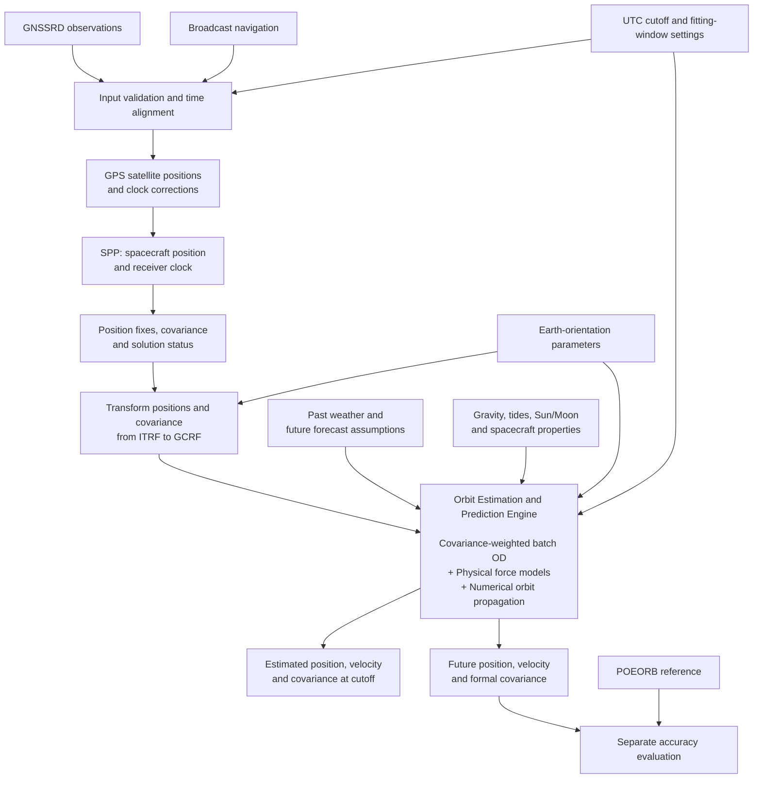

# Orbit estimation and prediction architecture

User-approved diagram: batch OD, physical force models and numerical propagation
are merged into one **Orbit Estimation and Prediction Engine**. This document
records the agreed structure; it does not claim that the algorithm has already
been refactored into one implementation class.

The cutoff is chosen before processing. Batch OD uses permitted observations to
estimate an orbit; inside the combined engine, its cutoff state starts numerical
propagation. The current-state block is a checkpoint output, not a second estimator.
POEORB is scoring-only for this GNSS-driven workflow. Covariance is formal uncertainty
under the assumptions in the estimator, not measured position error.

Excluded: sequential filtering, residual/consistency monitoring services,
outlier/maneuver investigation, recovery loops and planned-maneuver inputs.
Internal least-squares residual calculations are still necessary to solve SPP/OD.
The offline documentation assistant is separate from orbit computation.
