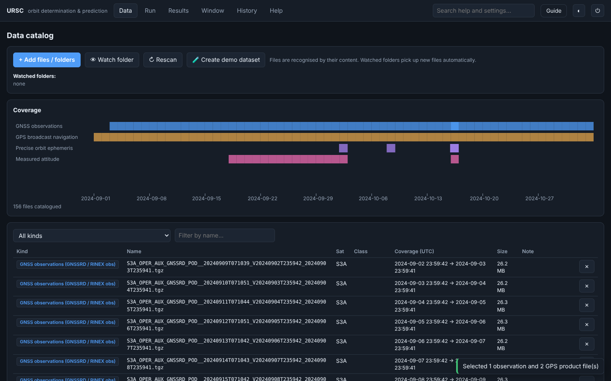
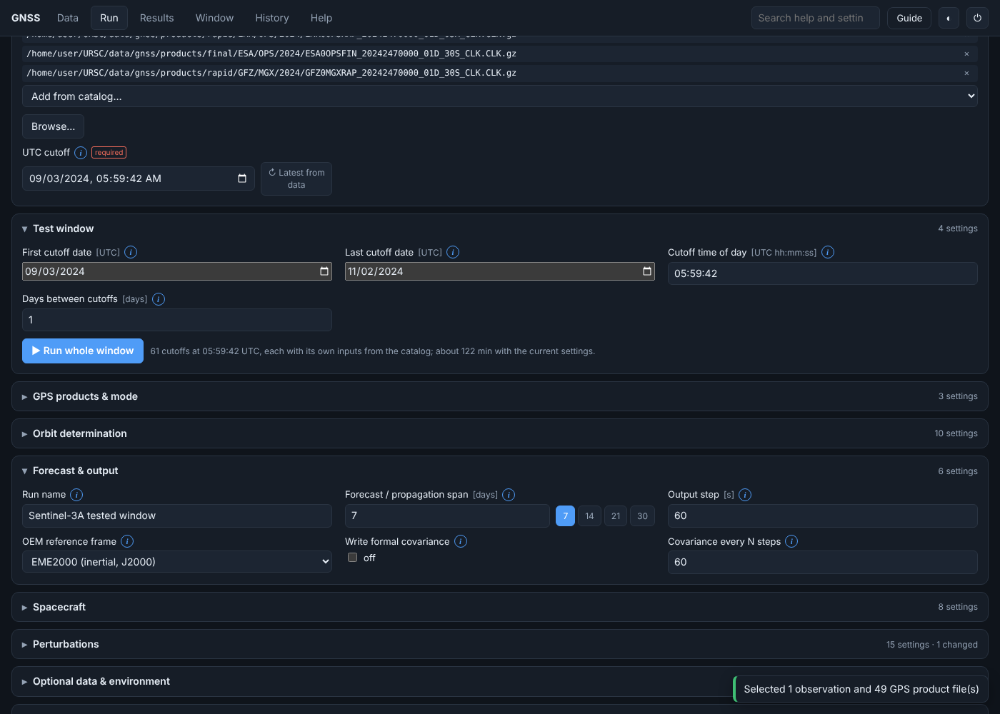
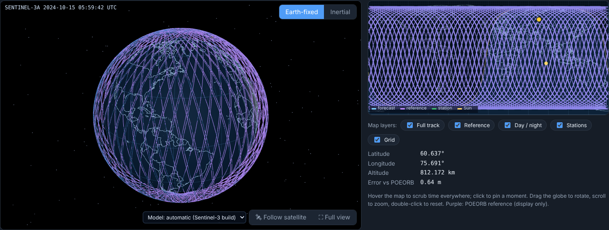
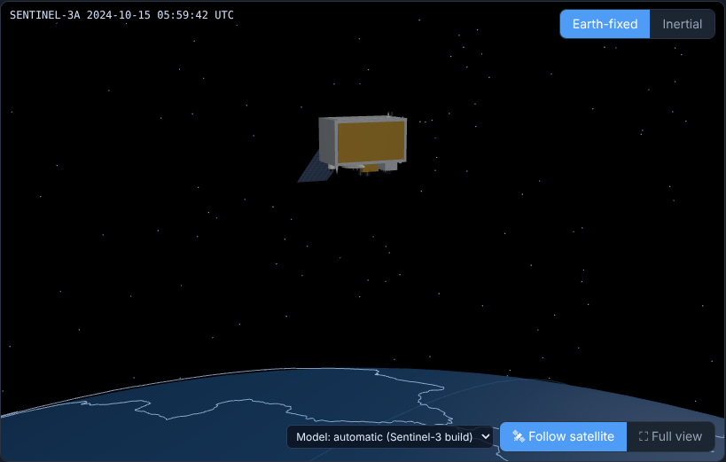
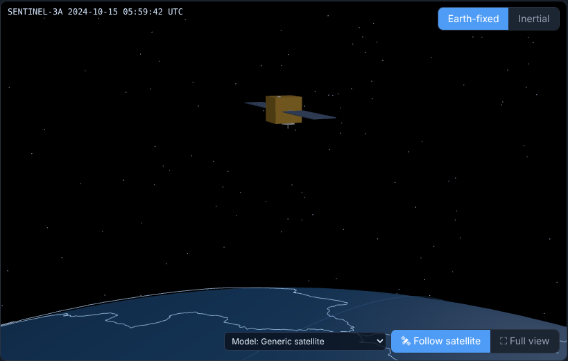
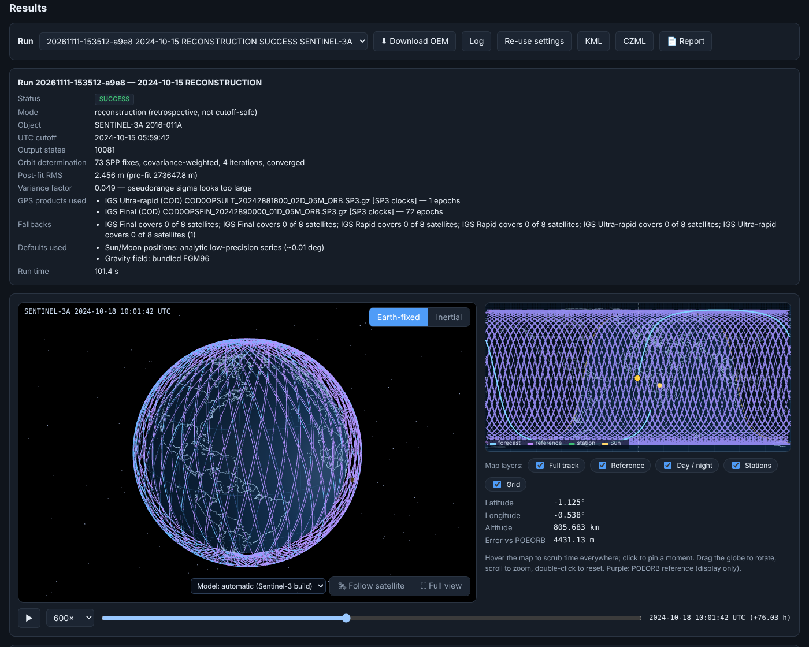
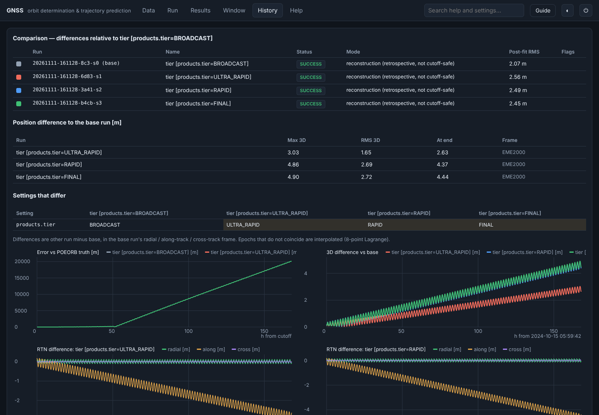
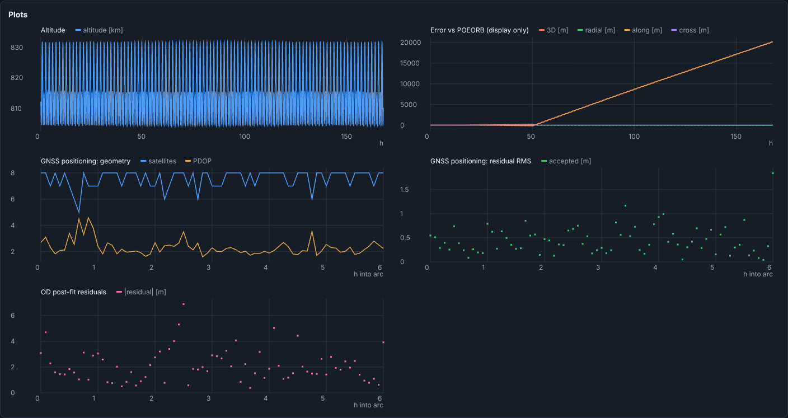

<div class="keyfacts">
<span>Test satellite <b>ESA Sentinel-3A</b></span>
<span>Campaign <b>2 Sep – 2 Nov 2024</b></span>
<span>61 daily cut-offs</span>
<span>Output <b>CCSDS OEM 2.0</b></span>
<span>Runs <b>fully offline</b></span>
</div>

> **Scope and intended audience.** This report documents an internship project: a software system
> that determines and forecasts the orbit of a Low Earth Orbit satellite from the satellite's own
> GPS measurements. It is written to be self-contained for a reader with a computing background but
> no prior knowledge of physics, orbital mechanics, or satellites. Every physical and mathematical
> term is defined where it first appears and is collected in the **Glossary**. Part I establishes
> the necessary foundations; subsequent parts rely on them.

---

# Part I — Foundations

## 1. What is an orbit?

A **satellite** is an object that travels around the Earth, and an **orbit** is the path it
follows. The reason it does not fall to the ground is best explained by Newton's thought
experiment: a cannonball fired horizontally from a tall mountain falls to Earth some distance away;
fired faster, it lands farther away; fired fast enough, the Earth's surface curves away beneath it
exactly as fast as the ball falls, so it continually "misses" the ground and circles the planet. An
orbit is therefore **continuous free-fall that keeps missing the Earth**.

The force responsible is **gravity**. **Newton's law of gravitation** states that two masses attract
each other with a force

$$ F = \frac{G\,M\,m}{r^{2}}, $$

where *M* is the Earth's mass, *m* the satellite's mass, *r* the distance between their centres, and
*G* a universal constant. The force decreases with the **square** of distance. Combined with
**Newton's second law** (force equals mass times acceleration, $F = ma$), this determines the
satellite's acceleration at any instant; knowing the position and velocity *now* therefore fixes the
position a moment later. Repeating that determination over small time steps is precisely what
"predicting the trajectory" means (§9).

**Low Earth Orbit (LEO)** denotes an orbit a few hundred kilometres above the surface. The test
satellite, **Sentinel-3A** (an ESA Earth-observation satellite), orbits at approximately **815 km**
and completes one revolution roughly every **100 minutes** — about fifteen times per day.

If the Earth were a perfect, uniform sphere in empty space, an orbit would be a fixed ellipse
(Kepler, 1609). The real Earth is non-spherical and non-uniform, possesses an atmosphere, and shares
space with the Sun and Moon; consequently the orbit evolves over time. Modelling that evolution
accurately is the central technical problem addressed by this project (Parts IV and V).

## 2. Describing an orbit: state vectors and orbital elements

An orbit can be described in two equivalent ways.

A **state vector** consists of six numbers: three for **position** $(x, y, z)$ and three for
**velocity** $(v_x, v_y, v_z)$, expressed in an agreed coordinate system (§4). This is the
representation the software integrates forward in time.

The **orbital (Keplerian) elements** describe the shape and orientation of the orbital ellipse and
are more intuitive for interpretation:

| Element | Symbol | Meaning |
|---|---|---|
| Semi-major axis | *a* | the size of the orbit (mean radius) |
| Eccentricity | *e* | how elongated the ellipse is (0 = circle) |
| Inclination | *i* | the tilt of the orbital plane relative to the equator |
| Right ascension of the ascending node | *Ω* | the orientation of the orbital plane about the Earth's axis |
| Argument of perigee | *ω* | the orientation of the ellipse within its plane |
| True anomaly | *ν* | the satellite's current position along the orbit |

The two representations carry identical information, and the software converts between them without
loss. Sentinel-3A occupies a nearly circular ($e \approx 0.001$), highly inclined
($i \approx 98.6^{\circ}$) **Sun-synchronous** orbit, in which the orbital plane rotates about
$1^{\circ}$ per day so that the satellite crosses any given latitude at a fixed local solar time —
advantageous for consistent illumination in Earth imaging. The lowest and highest points of an
orbit are the **perigee** and **apogee**; an **epoch** is the specific instant at which a state is
defined.

## 3. Time in space

Because radio signals travel at approximately $3 \times 10^{5}$ km s⁻¹, a timing error of one
microsecond corresponds to a position error of about 300 metres. Several time scales are therefore
maintained and converted precisely:

- **TAI (International Atomic Time)** — a uniform count of seconds from atomic clocks.
- **UTC (Coordinated Universal Time)** — civil time; TAI minus an integer number of **leap seconds**
  (occasional one-second insertions that keep UTC aligned with the Earth's slightly irregular
  rotation). The software holds the complete 1972–2017 leap-second table.
- **GPS time** — the time scale of the GPS system; TAI minus 19 seconds, with **no** leap seconds
  (it therefore drifts from UTC by whole seconds over the years). In the tested period, a cut-off of
  05:59:42 UTC equals exactly 06:00:00 GPS, which is why that value is used.
- **UT1** — time tied to the Earth's actual rotation angle; it differs from UTC by less than one
  second (the difference *UT1 − UTC* is a measured quantity, §4).

## 4. Reference frames

A position is meaningful only relative to a **reference frame** (coordinate system). Two are
relevant:

- The **inertial frame (GCRF / EME2000, also called J2000)** is fixed relative to the distant stars
  and does not rotate with the Earth. The equations of motion are simplest in this frame, so the
  physical simulation is performed here.
- The **Earth-fixed frame (ITRF)** rotates with the Earth, so geographic features remain stationary.
  Latitude, longitude and ground tracks are naturally expressed here, as are GPS measurements.

Converting between the two requires an accurate model of the Earth's orientation in space, which
comprises four effects: the daily **rotation**; **precession**, the slow (~26,000-year) conical
sweep of the rotation axis; **nutation**, smaller and faster axis oscillations driven by the Moon;
and **polar motion**, an irregular wander of the rotation pole by a few metres across the surface.
The software implements the full international standard (IAU-2006 precession, IAU-2000B nutation,
Earth-rotation angle, and polar motion), validated against the reference SOFA library. The measured
corrections for the Earth's irregular rotation — collectively **Earth Orientation Parameters
(EOP)** — are published by the **IERS** (International Earth Rotation and Reference Systems Service).
When no EOP file is supplied, the software assumes $UT1 = UTC$ and zero polar motion, which is
adequate to the metre level used here.

Errors are frequently expressed in a satellite-centred **RTN frame**: **radial** (up–down),
**along-track** (forward–back along the velocity, where drag error accumulates), and **cross-track**
(lateral). This separation distinguishes a satellite that is slightly ahead or behind on an
otherwise correct orbit from other error types.

---

# Part II — Problem and context

## 5. Motivation and objectives

Once a satellite is operational, two questions recur continually: *where is it now?* — **orbit
determination (OD)**, the reconstruction of the true orbit from measurements — and *where will it be
next?* — **trajectory prediction** or **propagation**, the forward simulation of the physics. These
underpin camera pointing, scheduling of ground-station contacts, re-entry prediction, and collision
avoidance in an increasingly congested orbital environment.

Modern LEO satellites carry a **GPS receiver** and record the navigation signals they receive, in
the same manner as a terrestrial GPS device but from orbit. These recordings are the primary
measurement. The objective of this project was to implement a single, configurable software system
that converts those recordings into a trustworthy orbit and forecast, writes results in the
international standard format, provides an interactive interface, and runs on a **single computer
with no internet connection** — a requirement of many secure, "air-gapped" space-operations
facilities. The system was to be validated on a real satellite over a real period: **Sentinel-3A,
2 September – 2 November 2024**.

---

# Part III — Measurements and data

## 6. Measuring position with GPS

**GNSS and GPS.** A *Global Navigation Satellite System* (GNSS) is a satellite positioning system;
**GPS** is the American system, comprising approximately 30 satellites at an altitude of about
20,000 km. Each GPS satellite continuously broadcasts a timing signal encoding its identity,
position, and the transmission time.

**Pseudorange.** A receiver compares the arrival time of a signal with its transmission time; the
difference multiplied by the speed of light yields a distance, termed a **pseudorange** ("pseudo"
because the receiver's own clock error is embedded in every measurement).

**Single-point positioning (SPP).** Given pseudoranges to four or more GPS satellites at one
instant, four unknowns can be solved — the receiver's three position coordinates and its clock
error. Geometrically, each pseudorange constrains the receiver to a sphere about the transmitting
satellite, and the spheres intersect at the receiver. The quality of the geometry is summarised by
the **PDOP (Position Dilution of Precision)**; a lower value indicates better-conditioned geometry.
Performing SPP at every epoch produces a set of position **fixes**, the input to orbit
determination.

**GPS products.** A pseudorange is usable only if the transmitting satellite's position and clock at
the moment of transmission are known. This information is distributed as **GPS products**, which
trade accuracy against latency:

| Product | Source | Accuracy | Availability |
|---|---|---|---|
| **Broadcast** | transmitted by GPS | ~1–2 m | immediate (real time) |
| **Ultra-rapid** | IGS (predicted + observed) | ~5 cm | within hours |
| **Rapid** | IGS | ~2.5 cm | ~1 day |
| **Final** | IGS | ~2 cm | ~1–2 weeks |

The **IGS (International GNSS Service)** is a global scientific collaboration; its analysis centres —
**CODE** (Switzerland), **ESA**, **EMR** (Canada) and **GFZ** (Germany) — each publish products. The
precise products comprise two files: **SP3** (satellite positions) and **CLK** (satellite clocks).
The software selects the most accurate product actually available for the chosen time, with
automatic fall-back per satellite and per epoch.

**Input file types.** The satellite's raw GPS observations are supplied in **GNSSRD** files (the
mandatory measurement input, in the **RINEX** standard format, versions 3 and 4). ESA's precise,
after-the-fact reconstructed orbit for Sentinel-3 is the **POEORB** file; it is used **only to
evaluate** results and is never an input. The **PROQUA** file contains the satellite's measured
**attitude** (pointing direction) and is used only for optional box-wing shape modelling.

**Output format.** Every result is written as a **CCSDS OEM** (Orbit Ephemeris Message) — the
Consultative Committee for Space Data Systems' international standard for an ephemeris — so that
other tools can consume it. The software additionally exports **KML** (Google Earth) and **CZML**
(Cesium) tracks.

The **bundled dataset** for the tested window contains, for Sentinel-3A: 62 days of GNSSRD GPS
observations, 63 PROQUA attitude files, 63 POEORB reference orbits, and GPS products from several
IGS analysis centres (Broadcast, Final, Rapid, and Ultra-rapid), together totalling approximately
950 catalogued input files, each with a recorded checksum.

---

# Part IV — The physics of the forecast

## 7. Forces acting on the satellite

Forecasting the orbit requires solving the **equation of motion**, Newton's second law written for
the satellite:

$$ \ddot{\mathbf r} = \mathbf a_{\text{gravity}} + \mathbf a_{\text{drag}} + \mathbf a_{\text{SRP}} + \mathbf a_{\text{Sun,Moon}} + \mathbf a_{\text{tides}} + \mathbf a_{\text{relativity}} + \cdots $$

where $\mathbf r$ is the position and $\ddot{\mathbf r}$ its acceleration (the second time
derivative). The right-hand side is the sum of accelerations from every modelled force. Each force
is an independent, switchable module.

**7.1 Central gravity.** To first approximation the Earth is a point mass and the acceleration is
$-\mu\,\mathbf r / r^{3}$, where $\mu = GM$ is the Earth's gravitational parameter. This term alone
yields Kepler's fixed ellipse.

**7.2 Non-spherical gravity.** The real Earth bulges at the equator and has internal density
variations. Its gravitational field is represented by a **spherical-harmonic expansion** — a sum of
standard spatial patterns indexed by **degree** (north–south detail) and **order** (east–west
detail), each with a fitted coefficient. The dominant correction, **J2**, represents the equatorial
bulge and causes the orbital plane to regress slowly (**nodal regression**) and the ellipse to
rotate. The software uses the **EGM96** field to **degree and order 70** ("70×70"); computational
cost grows roughly with the square of the degree, and the accuracy benefit saturates near degree 70
at this altitude.

**7.3 Solar radiation pressure (SRP).** Sunlight carries momentum, producing a small continuous
acceleration away from the Sun that depends on the illuminated area, the surface reflectivity
coefficient **Cr**, and whether the satellite is sunlit or in shadow. The Earth's shadow is modelled
with a realistic cone geometry comprising the full-shadow **umbra** and the partial **penumbra**.

**7.4 Third-body gravity.** The Sun and Moon also attract the satellite; because they attract the
satellite and the Earth slightly differently, the difference perturbs the orbit. Their positions are
obtained from compact analytical series (accurate to a fraction of a degree) or, optionally, from a
high-precision JPL DE440 ephemeris file.

**7.5 Solid and ocean tides.** The same lunar and solar attraction that raises ocean tides also
deforms the solid Earth and redistributes ocean water, slightly altering the Earth's gravity field
over time. Both the solid-Earth tide and the ocean tide (bundled FES2004 model) are included,
following the IERS-2010 conventions.

**7.6 General relativity.** Newtonian gravity is extremely accurate but not exact; the
**Schwarzschild** correction of general relativity, together with the smaller **Lense–Thirring**
(frame-dragging) term arising from the Earth's rotation, are both included.

**7.7 Earth albedo and infrared.** Sunlight reflected from the Earth (**albedo**) and thermal
infrared radiation emitted by the Earth exert a smaller radiation pressure, modelled with the
Knocke–Ries formulation.

**7.8 Empirical acceleration.** A small, constant, adjustable acceleration used to absorb forces not
otherwise modelled; disabled by default.

## 8. Atmospheric drag and the density models

Atmospheric drag is treated separately because it is the **dominant source of forecast error for
LEO**, and because the atmospheric **density models** are the principal source of difficulty.

**8.1 Why drag matters.** Even at 815 km a trace atmosphere remains. As the satellite travels through
it at approximately 7.5 km s⁻¹, it experiences resistance that gradually removes energy and lowers
the orbit. The **drag acceleration** is

$$ \mathbf a_{\text{drag}} = -\tfrac{1}{2}\,\rho\,\frac{C_d A}{m}\,v^{2}\,\hat{\mathbf v}, $$

where **ρ** is the local atmospheric **density**, *v* the speed, $\hat{\mathbf v}$ the direction of
motion, *A* the cross-sectional area, *m* the mass, and **Cd** the drag coefficient. The grouping
$C_d A / m$ is the **ballistic coefficient**, a measure of how strongly a satellite is affected by
drag for its mass.

**8.2 Why it is difficult.** Every quantity in the drag equation is reasonably well known except the
density **ρ**. At a fixed altitude, upper-atmospheric density can vary by a factor of ten or more
with solar activity, which itself is not predictable days in advance. The forecast error is
therefore governed chiefly by how accurately ρ can be modelled and predicted. The software provides
several **density models** (atmosphere models), trading computational cost against realism.

**8.3 Exponential.** The simplest model: $\rho = \rho_{0}\,e^{-(h - h_{0})/H}$, where *H* is the
**scale height** (the altitude increase over which density falls by a factor $e \approx 2.718$). It
has no time dependence. It is fast and crude, suitable for illustrative runs.

**8.4 Harris–Priester.** Adds the **diurnal bulge**: the atmosphere is denser on the day side than
the night side because solar heating inflates it, with the maximum lagging to approximately 14:00
local solar time. The model interpolates between tabulated minimum and maximum density profiles
using the angle between the satellite and the bulge apex. It does not respond to solar activity but
captures the day–night asymmetry at low cost.

**8.5 NRLMSISE-00 (default, high fidelity).** The name denotes *US Naval Research Laboratory — Mass
Spectrometer and Incoherent Scatter radar — Extended — 2000*. It is an **empirical** model, fitted
to decades of measurements (satellite drag data, spacecraft mass-spectrometer readings, and ground
radar). Given altitude, latitude, longitude, local solar time, day of year, and the prevailing solar
and geomagnetic activity, it returns the temperature and the number densities of the constituent
gases (molecular nitrogen, atomic oxygen — dominant at these altitudes — molecular oxygen, helium,
hydrogen, argon, atomic nitrogen), from which the total mass density follows. The implementation
reproduces the model's official reference case to seven significant figures in the automated test
suite. It is the most realistic of the shipped models and the default.

**8.6 JB2008 (Jacchia–Bowman 2008).** A further high-fidelity empirical model that tracks density
during geomagnetic storms particularly well by incorporating additional solar indices; it is offered
as an alternative to NRLMSISE-00 for demanding cases.

**8.7 Space-weather drivers.** The high-fidelity models require a measure of solar activity, supplied
as two **space-weather indices**:

- **F10.7** — the Sun's radio flux at a wavelength of 10.7 cm, measured daily; an effective proxy for
  the extreme-ultraviolet radiation that heats and expands the thermosphere. Higher F10.7 implies a
  denser upper atmosphere and greater drag.
- **Ap** — a daily **geomagnetic** activity index. During geomagnetic storms, energy is deposited in
  the upper atmosphere, heating it and raising density globally. Higher Ap implies greater drag.

These indices are read from a space-weather file (a CelesTrak CSSI file for historical values), with
constant values used when none is supplied. Because F10.7 and Ap cannot be predicted precisely days
in advance, even a perfect density model leaves an irreducible forecast uncertainty — the principal
reason the forecast error grows to approximately 20 km over seven days (§13–§14).

---

# Part V — The mathematics

## 9. Computational methods

Four computational stages convert raw GPS measurements into an evaluated forecast.

**9.1 Single-point positioning.** At each epoch there are several pseudoranges and four unknowns
(position and clock error), generally over-determined and noisy. The position and clock that best
fit all the pseudoranges are found by **least squares** — minimising the sum of squared differences
between measured and computed distances. As distance depends non-linearly on position, the solution
is obtained iteratively (linearise, correct, repeat). Each epoch yields one position **fix** and
associated quality indicators.

**9.2 Numerical integration.** The equation of motion (§7) specifies the acceleration at any state;
the trajectory over time is required. No closed-form solution exists once drag and non-spherical
gravity are included, so the orbit is integrated **numerically**, advancing the state in small time
steps and re-evaluating every force at each step. The software uses the **Dormand–Prince 5(4)**
method, a **Runge–Kutta** integrator that computes each step to both fifth- and fourth-order
accuracy; the difference estimates the local error, which is used to **adapt the step size**
automatically. Two **tolerances** (relative and absolute) set the permitted per-step error; tighter
tolerances produce more, smaller steps — more accurate but slower. Integrating the summed forces
directly in this way is **Cowell's method**. A faster semi-analytical **DSST** mean-element
propagator is also available for very long runs.

**9.3 Batch least-squares orbit determination.** The position fixes do not lie on any single perfect
orbit. Orbit determination finds the single physically consistent orbit that best fits them, as
follows: (1) an initial state is assumed at the cut-off; (2) it is propagated (§9.2) and compared
with the fixes, the differences being the **residuals**; (3) the sensitivity of each residual to
each component of the initial state — the **Jacobian** — is computed by **finite differences**
(perturb a component, re-propagate, difference), so the method is independent of the force model
used; (4) a correction that most reduces the squared residuals is solved (**Gauss–Newton**), with
parameter scaling and step-halving for stable convergence; (5) the process repeats until it
converges. The fit quality is reported as the **post-fit RMS** (root-mean-square residual, in
metres), and the **variance factor** compares the observed residual scatter with the assumed
measurement noise (a value near one indicates a consistent noise assumption). Optionally the drag
coefficient (and reflectivity) are estimated alongside the state, absorbing modelling error.

**9.4 Covariance propagation.** A single predicted position is incomplete without its uncertainty.
The **covariance** is a matrix expressing the uncertainty of each state component and the
correlations between them. Orbit determination yields a covariance at the cut-off; to report it
along the forecast, the software propagates it with the **state-transition matrix** — the matrix
relating a small change in the initial state to the change at a later time — again obtained by finite
differences. The result is written into the OEM and can be displayed as an uncertainty ellipsoid or
as radial/along/cross (RTN) standard-deviation curves. Because covariance costs approximately one
additional propagation per estimated parameter, it is optional and disabled in the fast default
profile.

---

# Part VI — System design

## 10. Software architecture

The system is a single Java application with **no external runtime dependencies**; the numerical
core is plain, auditable Java. It is organised in three layers.

<div class="flow">
<div class="node"><b>Input files</b><br><span class="sub">GNSSRD, broadcast, SP3+CLK, POEORB, PROQUA, EOP, weather, gravity</span></div>
<div class="arrow">→</div>
<div class="node accent"><b>Data catalogue</b><br><span class="sub">recognise by content · coverage, satellite, SHA-256 · select per run</span></div>
<div class="arrow">→</div>
<div class="node accent"><b>Engine</b><br><span class="sub">single-point positioning → batch orbit determination → propagation (forces §7–8)</span></div>
<div class="arrow">→</div>
<div class="node"><b>Outputs</b><br><span class="sub">CCSDS OEM (+covariance), KML, CZML, printable report, log, evaluation</span></div>
</div>

<p style="text-align:center;color:#5a6b7d;font-size:12.5px;margin-top:2px">A local web server on 127.0.0.1 serves the browser interface (run setup, 3-D globe, 2-D map, plots, comparisons) over the engine; no data leaves the computer.</p>

**Layer 1 — the engine.** The numerical core: readers for every input format; single-point
positioning; batch orbit determination; the switchable force models of Part IV; the Dormand–Prince
integrator; and the CCSDS OEM writer. Representative packages: `gnss` and `gnss.products` (RINEX and
SP3/CLK readers, the broadcast adapter, and the product resolver); `pipeline` (the run configuration,
the orbit-determination/forecast pipeline, the propagate-from-state workflow, the reference
comparison, and the process-wide environment); the force models and `propagation` (numerical and DSST
propagators); `io` (OEM reader/writer, KML, CZML); and `frames` and time utilities.

**Layer 2 — the data catalogue.** The `data.DataCatalog` component scans input files, recognises each
by its **content** rather than its name, records its time coverage, satellite, product class, and a
**SHA-256 checksum** (a short fingerprint of the file's bytes, so each result records exactly which
inputs produced it), and selects the appropriate files for a given cut-off.

**Layer 3 — the interface.** A small local web server (`app.gui.GuiServer`, built on the JDK's
built-in HTTP server) binds to 127.0.0.1 only and serves a browser interface. Progress is streamed to
the browser; each run is stored under a run directory containing its configuration, outputs, and log,
making every result reproducible. The browser is merely the display; no data leaves the computer, and
even the help search operates offline.

**Processing modes.** A run operates in one of two product modes — **Forecast** (cut-off-safe: only
products available at the cut-off are used, as in a real operation) or **Reconstruction**
(retrospective: the most accurate products present are used) — and in one of two workflows: the full
**orbit-determination + forecast**, or **propagation from a single supplied state**.

## 11. Processing pipeline

For a chosen cut-off, the system executes the following chain on the **Orekit** flight-dynamics
engine (illustrated below):

<div class="flow">
<div class="node">GPS code + carrier phase</div><div class="arrow">→</div>
<div class="node">Starting orbit (code positions)</div><div class="arrow">→</div>
<div class="node accent">Orekit batch least squares on carrier phase</div><div class="arrow">→</div>
<div class="node">Orekit numerical propagation (7 d)</div><div class="arrow">→</div>
<div class="node accent">CCSDS OEM + evaluation</div>
</div>

1. **Input selection** from the catalogue: the satellite's GPS observations over the arc (six hours
   by default), the best available GPS products, and the POEORB reference (for evaluation only).
   Orekit's parsers read the RINEX observations, the SP3 and clock products and the broadcast
   navigation messages.
2. **Starting orbit.** Single-point code positions every 300 s (§9.1) give an initial orbit through
   Orekit's Gibbs method and a quick Orekit batch fit. They only start the next step.
3. **Orbit determination.** An Orekit batch least-squares fit uses the undifferenced
   ionosphere-free **code and carrier phase** of every GPS satellite in view, every 30 s. It
   estimates:
   * the orbit;
   * one receiver clock per epoch;
   * one float ambiguity per continuous phase arc.

   It also handles cycle slips and the antenna offset (§9.3,
   [CARRIER_PHASE_OD.md](CARRIER_PHASE_OD.md)).
4. **Propagation.** The fitted orbit is integrated forward by the Orekit numerical propagator
   (seven days by default), applying the forces of Part IV, with a position recorded every 60 s
   (§9.2).
5. **Output.** The run writes:
   * a CCSDS OEM (optionally with the covariance from Orekit's state-transition matrix);
   * KML and CZML files;
   * a printable report;
   * a log.

   Where a POEORB reference is present, the error against it is computed for display only.

> Earlier versions of this system fitted the orbit to the single-point position fixes, with its own
> physics library; the campaign of §13 was produced that way. §13a compares that method with the
> carrier-phase orbit determination on the same 61 days.

## 12. Features and interface



*Figure 1 — The Data tab. Each file is identified by its content and placed on a coverage timeline
(blue = GPS observations, gold = broadcast navigation, purple = reference orbits, pink = attitude).*



*Figure 2 — The Run tab. It opens on the tested Sentinel-3A settings. The forecast length offers
one-click 7/14/21/30-day presets; the cut-off can be filled automatically from the data; every
setting carries an explanatory note.*

**Three-dimensional globe and interactive two-dimensional map.** Results are displayed on a 3-D globe
and a flat **ground-track** map (the path of the point directly beneath the satellite) side by side.
Moving the pointer over the map scrubs time across the globe and the plots simultaneously; clicking
pins a moment. Display layers (forecast track, reference orbit, day/night shading, ground stations)
can be toggled.



*Figure 3 — The Results view. Left: the orbit on the 3-D globe. Right: the ground track on the 2-D
map with day/night shading. Pointer motion over the map updates the latitude, longitude, altitude and
the error-versus-reference readout in real time.*

**Satellite models.** Sentinel-3A is rendered as a recognisable three-dimensional model; any other
satellite is drawn with a generic build. A follow camera travels alongside the satellite.

<p>


</p>

*Figure 4 — Left: the Sentinel-3A model in nadir-pointing follow mode. Right: the generic model used
for other satellites.*

**Window processing.** The Window tab repeats orbit determination and forecasting for every day in a
date range — the campaign comprises 61 daily cut-offs — and charts the trends in fit quality, number
of GPS fixes, and forecast error.


*Figure 5 — The two-month window result: 61 of 61 days produced a forecast, with a median fit error
of 2.35 m and none flagged.*

**Reconstruction with precise products.** In Reconstruction mode the most accurate product present is
used; Figure 6 shows a run using CODE Final products for 72 of its 73 epochs.



*Figure 6 — A reconstruction run at the 2024-10-15 cut-off; "GPS products used" lists IGS Final (COD);
post-fit RMS 2.456 m.*

**Product comparison.** A single action runs the same case with each product tier and overlays their
errors against the POEORB reference on one chart (analysed in §14).



*Figure 7 — The four product tiers overlaid.*

**Offline help (retrieval-augmented).** The Help tab answers questions without internet access using
**retrieval-augmented generation (RAG)**: it first **retrieves** the most relevant passages from the
bundled documentation (ranked by the classic **BM25** text-ranking method), then **generates** an
answer from those passages alone, citing each source, so it cannot fabricate information.


*Figure 8 — The offline help pipeline: question → retrieve passages (BM25) → cited answer. An optional
local or cloud model may phrase the answer from the same passages; retrieval remains offline.*

**Diagnostics.** Every run produces engineering plots — altitude, GPS geometry and satellites in view,
positioning residuals, orbit-determination residuals, and, where a reference exists, the
radial/along/cross-track error.



*Figure 9 — Diagnostic plots supporting assessment of fit and forecast quality.*

---

# Part VII — Experimental results

## 13. The two-month campaign: results

The system was run once for each of the **61 daily cut-offs** from 3 September to 2 November 2024,
with frozen test settings: a six-hour measurement arc, a seven-day forecast, EGM96 70×70 gravity, and
NRLMSISE-00 drag.

| Measure | Result | Interpretation |
|---|---|---|
| Forecasts issued | **61 of 61** | every day converged; none flagged as a possible manoeuvre |
| Orbit-fit post-fit RMS | median **2.35 m** (range 1.85–4.38 m) | closeness of the fitted orbit to the GPS fixes |
| GPS fixes per cut-off | 73 | one fix per 300 s over the six-hour arc |
| Run time per cut-off | ≈ 125 s | ≈ 2 hours for the full window on one computer |
| Error vs POEORB at the cut-off | 2.17 m (8 Oct); 0.48 m (16 Oct) | accuracy of the instantaneous orbit |
| Error vs POEORB after 1 day | 268 m (7 Oct); 28.7 m (15 Oct) | accuracy of the one-day forecast |

An error figure is available only for days whose Sentinel-3A reference orbit is in the bundled data;
the reference is used for evaluation, never as an input.

Beyond the campaign, more than 120 automated tests verify the underlying mathematics: loss-free orbit
conversions, energy conservation under two-body motion, the J2 nodal-regression formula, the
leap-second table, NRLMSISE-00 against its official reference case to seven significant figures,
batch-OD recovery of a known state and drag coefficient from synthetic data, and CCSDS OEM
round-trips. The propagator is additionally checked against real Sentinel-3A precise orbits.

## 14. Accuracy as a function of GPS product

To quantify how the choice of GPS product affects accuracy, the same case (cut-off 2024-10-15,
Reconstruction mode) was run with each product tier. Two comparisons are informative.

**(a) Instantaneous orbit quality (post-fit RMS at the cut-off).**

| Product tier | Post-fit RMS | Relative to broadcast |
|---|---|---|
| Broadcast | 2.07 m | baseline |
| Ultra-rapid (CODE) | 2.56 m | +0.49 m |
| Rapid (CODE) | 2.49 m | +0.42 m |
| Final (CODE) | 2.45 m | +0.38 m |

**(b) Orbit difference relative to the broadcast run, over the seven-day forecast** (how far each
tier's trajectory diverges from the broadcast trajectory):

| Product tier | Maximum 3-D difference | RMS 3-D difference | Difference at seven days |
|---|---|---|---|
| Ultra-rapid | 3.03 m | 1.65 m | 2.63 m |
| Rapid | 4.86 m | 2.69 m | 4.37 m |
| Final | 4.90 m | 2.72 m | 4.44 m |

**Interpretation.** The tiers differ at only the **few-metre** level. When each run's error is
plotted against the POEORB reference (Figure 7), the four curves very nearly coincide, because over a
seven-day forecast the trajectory drifts by approximately **20 km** through atmospheric-drag
uncertainty (§8), which dwarfs the metre-level differences between GPS products. The practical
conclusion is significant: **for a multi-day LEO forecast, the forecast horizon and the drag model
dominate the error, not the choice of GPS product.** The product choice matters most for the
*instantaneous* orbit at the cut-off, where the error is at the sub-metre to few-metre level. This
finding justifies the system's design emphasis on a high-fidelity, switchable drag model and on
honest reporting of forecast uncertainty.

## 15. Difficulties encountered and resolutions

The project surfaced several substantive problems. Each was diagnosed, resolved, and covered by a
regression test so that it cannot silently recur.

<div class="problem">
<h4>15.1 Stale broadcast navigation at day boundaries</h4>
<p><span class="tag tag-problem">Problem</span> When two consecutive days of broadcast navigation
were loaded, the first two hours after midnight were served with outdated navigation messages,
because each daily file was treated as a separate source.</p>
<p><span class="tag tag-impact">Impact</span> The orbit-determination post-fit RMS on affected days
inflated from about 2 m to 8–12 m, and the residual jumps triggered false "possible manoeuvre"
warnings.</p>
<p><span class="tag tag-fix">Resolution</span> All broadcast files are now merged into a single
source that selects, for each satellite and epoch, the message whose time of ephemeris is nearest.
The RMS returned to approximately 2 m and the false flags disappeared. A regression test covers the
merge.</p>
</div>

<div class="problem">
<h4>15.2 Reference orbit of the wrong satellite</h4>
<p><span class="tag tag-problem">Problem</span> A repository file named <code>S3A_POEORB_…</code>
in fact contained <b>Sentinel-3B</b> data, as its own internal header declared.</p>
<p><span class="tag tag-impact">Impact</span> For two days, Sentinel-3A forecasts were evaluated
against a Sentinel-3B orbit, producing a meaningless error of about 13,000 km. The forecasts
themselves were correct.</p>
<p><span class="tag tag-fix">Resolution</span> The catalogue now reads the satellite identity from
each reference file's header and compares only against the matching satellite. A regression test
asserts the correct attribution and exclusion.</p>
</div>

<div class="problem">
<h4>15.3 Rejected high-rate precise clocks</h4>
<p><span class="tag tag-problem">Problem</span> The principal precise products are from CODE, whose
high-rate clock files place one character of the file header one column further right than the
standard specifies. The reader rejected all such files.</p>
<p><span class="tag tag-impact">Impact</span> 69 CODE Final and multi-GNSS clock files were discarded,
which would have prevented the corresponding Final orbits from being used at all.</p>
<p><span class="tag tag-fix">Resolution</span> The reader now accepts the file-type character in
either column. The 69 files were recovered and Reconstruction runs use IGS Final products end to end
(Figure 6). A regression test covers the shifted-column header.</p>
</div>

<div class="problem">
<h4>15.4 Build failure on Windows (symbolic links)</h4>
<p><span class="tag tag-problem">Problem</span> Three catalogue tests staged their input files using
symbolic links, which Windows refuses unless the account holds a special privilege.</p>
<p><span class="tag tag-impact">Impact</span> <code>mvn package</code> failed during the test phase on
Windows ("a required privilege is not held by the client"), so the build never produced the
application, although the code itself was correct.</p>
<p><span class="tag tag-fix">Resolution</span> The tests now fall back to copying the file when a
symbolic link cannot be created; since the tests only read the files, a copy is equivalent. The build
completes on both Linux and Windows.</p>
</div>

<div class="problem">
<h4>15.5 Run time and offline rendering performance</h4>
<p><span class="tag tag-problem">Problem</span> A full-fidelity run takes roughly two minutes, and the
window of 61 cut-offs runs sequentially; separately, the development server has no graphics hardware,
so 3-D rendering for screenshots and video is slow.</p>
<p><span class="tag tag-impact">Impact</span> The two-month window takes about two hours end to end,
and captured media required care to produce.</p>
<p><span class="tag tag-fix">Resolution</span> The default profile disables covariance propagation
(roughly halving per-run time) while retaining full physical fidelity; results remain reproducible.
Media were produced by deterministic frame-by-frame capture, with the satellite model enlarged for
visibility. True parallel execution across CPU cores was scoped as future work, because the
underlying library shares process-wide frame and ephemeris state that must first be isolated.</p>
</div>

---

# Part VIII — Discussion and reference

## 16. Advantages

- **Self-sufficient measurements.** The orbit is derived from the satellite's own GPS data, requiring
  no ground tracking network.
- **Modular, transparent physics.** Every force is an independent switch with a selectable model, so
  the fidelity–speed trade-off is controlled by configuration rather than code, and each force's
  contribution can be examined.
- **Standards-based output.** CCSDS OEM, KML and CZML allow results to be consumed directly by other
  space tools and viewers.
- **Reproducibility and auditability.** Each run stores its configuration and the checksums of its
  inputs; the engine is plain Java with no hidden dependencies.
- **Offline operation.** The system runs with no internet connection, as secure facilities require;
  even the help search is offline.
- **Honest validation.** Results are measured against real ESA precise orbits, which are never fed
  back into the computation.
- **Usability and explainability.** The interactive interface, comparisons, and illustrated guide make
  the system understandable rather than opaque.

## 17. Limitations

- **Real-time product availability.** A genuine forecast at the cut-off can use only broadcast
  navigation and the predicted portion of ultra-rapid products; Final and Rapid products become
  available one to two weeks later and are used in Reconstruction mode.
- **Seven-day drift.** Forecast error grows chiefly through atmospheric drag, which depends on
  unpredictable solar activity; a drift of about 20 km over seven days is expected at this altitude
  without updated space-weather input (§8, §14).
- **Simplifications.** Without an IERS EOP file, UT1 = UTC and polar motion are zero (a metre-level
  effect); Sun and Moon positions use analytical series unless a DE440 file is supplied. Both are
  clearly marked and adequate here.
- **Rendering.** Media were produced on hardware without a graphics processor, so the satellite model
  is enlarged and some captures are time-lapsed; on ordinary hardware the globe animates smoothly.
- **Licensing.** The NRLMSIS 2.0 and DTM2020 atmosphere models are not included for licensing reasons;
  the shipped drag options are exponential, Harris–Priester, NRLMSISE-00, and JB2008.

## 18. Running the software

Complete installation and execution instructions for both Linux and Windows — from installing Java
and Maven through building and launching — are provided in the project **[README](../README.md)**.
In summary:

```bash
mvn clean package                               # build (add -DskipTests to build faster)
java -jar target/leo-trajectory-0.1.0.jar gui   # start the browser interface
```

The program prints a local address of the form `http://127.0.0.1:…`, which opens automatically. On
the Run tab, selecting **Run** (or **Compare product tiers**) computes a case; the Results and Window
tabs present the output. The bundled two-month Sentinel-3A dataset is available immediately.

---

# Glossary

*Ordered broadly from general to specific. Every physical and mathematical term used in this report
appears here.*

**Satellite** — an object placed in orbit around the Earth.

**Orbit** — the path a satellite follows; physically, continuous free-fall that keeps missing the
Earth.

**Low Earth Orbit (LEO)** — an orbit a few hundred kilometres above the surface (Sentinel-3A ≈ 815
km), with a period of about 100 minutes.

**Gravity / Newton's law of gravitation** — the attraction between masses, $F = GMm/r^{2}$; it
weakens with the square of distance.

**Newton's second law** — force equals mass times acceleration, $F = ma$.

**Acceleration** — the rate of change of velocity; the second time derivative of position,
$\ddot{\mathbf r}$.

**Gravitational parameter (μ)** — the product $G \times M_{\text{Earth}}$.

**State vector** — six numbers giving a satellite's position and velocity at an instant.

**Orbital (Keplerian) elements** — six numbers describing an orbit's shape and orientation:
semi-major axis, eccentricity, inclination, right ascension of the ascending node, argument of
perigee, and true anomaly.

**Semi-major axis (a)** — half the long diameter of the orbital ellipse; its size.

**Eccentricity (e)** — how elongated the orbit is (0 = circle).

**Inclination (i)** — the tilt of the orbital plane relative to the equator.

**Perigee / apogee** — the lowest / highest points of an orbit.

**Sun-synchronous orbit** — an orbit whose plane precesses about 1° per day so the satellite crosses
a given latitude at a fixed local solar time.

**Epoch** — a specific instant at which a state or measurement is defined.

**Ephemeris** — a table of a satellite's position (and velocity) over time.

**TAI / UTC / GPS time / UT1** — time scales: uniform atomic time; civil time (TAI minus leap
seconds); GPS system time (TAI − 19 s, no leap seconds); and time tied to the Earth's rotation angle.

**Leap second** — an occasional one-second insertion into UTC to track the Earth's rotation.

**Reference frame** — a coordinate system for positions. **GCRF / EME2000 / J2000** is inertial (fixed
to the stars); **ITRF** rotates with the Earth.

**Precession / nutation / polar motion** — slow (~26,000-year), faster (Moon-driven), and irregular
(metre-scale) components of the Earth's changing orientation, required to convert between inertial and
Earth-fixed frames.

**Earth Orientation Parameters (EOP)** — measured corrections (UT1 − UTC, polar motion) for the
Earth's irregular rotation, published by the IERS.

**RTN (radial / along-track / cross-track)** — a satellite-centred frame for expressing errors: radial
(up–down), along-track (forward–back, where drag error accumulates), cross-track (lateral).

**Orbit determination (OD)** — reconstruction of the true orbit from measurements.

**Trajectory prediction / propagation** — forward simulation of the orbit by integrating the forces.

**GNSS / GPS** — satellite navigation systems in general / the American system (~30 satellites at
~20,000 km).

**GPS receiver** — a device that computes its position from GNSS signals; carried by LEO satellites.

**Pseudorange** — a distance measured from signal travel time, including the receiver's clock error.

**Single-point positioning (SPP)** — solving for a receiver's position and clock error from
pseudoranges at one instant.

**Fix** — one computed position from SPP at one epoch.

**PDOP (Position Dilution of Precision)** — a measure of GPS geometry quality; lower is better.

**GNSSRD** — the Sentinel-3 file of raw GPS observations; the mandatory measurement input.

**RINEX** — the standard text format for GNSS observations and navigation messages.

**GPS products / tiers** — the GPS satellites' positions and clocks, in increasing accuracy and
latency: Broadcast (real-time, ~1–2 m), Ultra-rapid (hours, ~5 cm), Rapid (~1 day, ~2.5 cm), Final
(~1–2 weeks, ~2 cm).

**IGS (International GNSS Service)** — the collaboration publishing precise GPS products; CODE, ESA,
EMR and GFZ are analysis centres.

**SP3 / CLK** — file formats for precise GPS orbit (SP3) and clock (CLK) products.

**Broadcast ephemeris** — the lower-accuracy GPS orbit/clock transmitted by the GPS satellites,
available in real time.

**POEORB (Precise Orbit Ephemeris)** — ESA's accurate reconstructed orbit for Sentinel-3; used only to
evaluate results, never as an input.

**PROQUA** — the Sentinel-3 file of measured attitude (pointing direction).

**Forecast mode vs Reconstruction mode** — using only products available at the cut-off (operational)
versus the best products present (retrospective).

**Cut-off (UTC cut-off)** — the instant separating measurement from forecast.

**Forecast span** — how far ahead the orbit is predicted (default seven days).

**Equation of motion** — Newton's second law for the satellite: acceleration equals the sum of all
force accelerations.

**Force model / perturbation** — any physical effect that changes the orbit; each is a switchable
module.

**Spherical-harmonic gravity** — a representation of the Earth's non-uniform gravity as a sum of
patterns indexed by degree (north–south detail) and order (east–west detail); EGM96 to 70×70 is used.

**J2 / nodal regression** — the largest non-spherical gravity term (equatorial bulge) and the slow
rotation of the orbital plane it causes.

**Atmospheric drag** — air resistance that gradually lowers a LEO orbit; the largest source of
forecast error.

**Density (ρ)** — mass of air per unit volume; the uncertain quantity in the drag equation.

**Ballistic coefficient** — the grouping $C_d A / m$ (drag coefficient × area ÷ mass).

**Drag coefficient (Cd)** — a dimensionless factor (≈2.2) in the drag equation.

**Scale height (H)** — the altitude increase over which density falls by a factor $e \approx 2.718$.

**Atmosphere / density models** — methods to compute ρ: Exponential (static), Harris–Priester (adds
the diurnal bulge), NRLMSISE-00 (empirical, solar/geomagnetic-driven — the default), JB2008
(empirical, strong during geomagnetic storms).

**Diurnal bulge** — the day-side swelling of the upper atmosphere from solar heating.

**Thermosphere** — the hot, very thin upper atmosphere (≈80–600+ km) where LEO drag occurs.

**Space weather (F10.7, Ap)** — indices of solar/geomagnetic activity that drive atmospheric density:
F10.7 (solar radio flux, a proxy for heating UV) and Ap (a geomagnetic index).

**Solar radiation pressure (SRP)** — the acceleration from sunlight's momentum, dependent on
reflectivity (Cr) and eclipse.

**Umbra / penumbra** — the full-shadow and partial-shadow regions of the Earth's shadow.

**Third body** — the perturbing gravity of the Sun or Moon.

**Solid / ocean tides** — deformation of the solid Earth and redistribution of ocean water under
Sun/Moon gravity, slightly altering the gravity field.

**General relativity (Schwarzschild, Lense–Thirring)** — small corrections to Newtonian gravity,
including the frame-dragging term from the Earth's rotation.

**Albedo / infrared radiation pressure** — accelerations from reflected sunlight and emitted thermal
radiation from the Earth.

**Empirical acceleration** — a small adjustable constant acceleration absorbing unmodelled forces.

**JPL DE440** — a high-precision planetary/lunar ephemeris file (optional).

**Numerical integration** — solving a differential equation by stepping forward in small time
increments.

**Cowell's method** — integrating the summed forces directly to obtain the orbit.

**Runge–Kutta / Dormand–Prince 5(4)** — a family of numerical integrators; Dormand–Prince 5(4)
computes each step to fifth- and fourth-order accuracy and adapts the step size from their
difference.

**Adaptive step size / tolerance** — automatic adjustment of step size to keep the per-step error
within relative and absolute tolerances.

**DSST** — a semi-analytical mean-element propagator that takes large steps, efficient for long runs.

**Residual** — the difference between a measurement and the model at one epoch.

**Least squares / Gauss–Newton** — fitting by minimising the sum of squared residuals; Gauss–Newton is
the iterative method for non-linear models.

**Jacobian / partial derivatives / finite differences** — the matrix of sensitivities of residuals to
the unknowns, here computed by perturbing each unknown and re-propagating.

**Batch least-squares orbit determination** — fitting one orbit to all position fixes simultaneously.

**Post-fit RMS** — the root-mean-square residual after OD converges; the fit-quality measure.

**Variance factor** — the ratio of observed residual scatter to assumed measurement noise; near one
indicates consistency.

**Covariance** — a matrix stating the uncertainty of the estimated state and the correlations between
components.

**State-transition matrix** — the matrix relating a small change in the initial state to its effect at
a later time; used to propagate covariance.

**CCSDS OEM (Orbit Ephemeris Message)** — the international standard text format for an ephemeris.
**KML / CZML** — formats for viewing tracks in Google Earth / Cesium.

**Ground track** — the path of the point on the Earth's surface directly beneath the satellite.

**SHA-256 checksum** — a short fingerprint of a file's contents, recorded for reproducibility.

**Air-gapped / offline** — a computer with no internet connection; the system runs entirely locally.

**Retrieval-augmented generation (RAG)** — answering a question by first retrieving relevant
documentation passages, then generating an answer from those passages with citations. **BM25** is the
text-ranking method used for retrieval.

**Manoeuvre flag** — a warning raised when orbit-determination residuals jump, possibly indicating a
thruster firing.

---

*Project: a reference-quality, extensible system for LEO orbit determination and trajectory
prediction from a satellite's own GPS data. Test satellite: ESA Sentinel-3A. Validation period:
2 September – 2 November 2024.*
