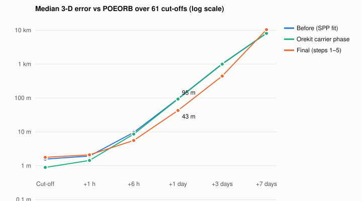
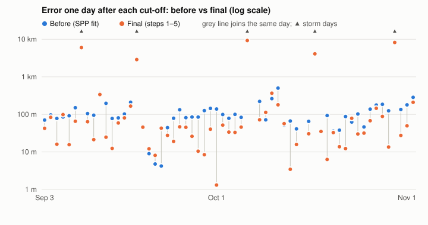

# How the system works: physics, mathematics, design and results

This document explains the physics, the mathematics, the software design and the experimental
results of the GNSS-based orbit determination and trajectory prediction tool. It is
self-contained: each section starts from first principles and ends with the exact way the
program implements it, with the setting names and the numbers it uses.

The test satellite throughout is **ESA Sentinel-3A**. The experiments cover **61 daily cut-offs
from 3 September to 2 November 2024**, each at 05:59:42 UTC. Every forecast is scored against
ESA's precise orbit product (**POEORB**), which is accurate to a few centimetres and is used for
scoring only, never as an input.

---

## 1. The problem in one page

A satellite in low Earth orbit (LEO) carries a GPS receiver. Every few seconds it records the
signals of the GPS satellites in view. From those recordings (the **GNSSRD** files, in RINEX
format) the program must:

1. **Determine the orbit (OD):** find the satellite's position and velocity at a chosen moment,
   the **cut-off**, using only data recorded up to that moment.
2. **Predict the trajectory:** integrate the equations of motion forward from the cut-off for up
   to 7 days (or longer) and write the result as a standard CCSDS OEM file.

Two rules govern every run:

* **Cut-off safety.** Nothing published or measured after the cut-off may be used: not GPS
  products, not Earth-orientation values, not solar or geomagnetic indices. A forecast that
  peeks at the future would look good in tests and fail in operations.
* **Scoring is separate.** POEORB is read only after the run, to measure the error.

The answer quality depends on two very different things:

| Phase | What limits accuracy | Typical size |
|---|---|---|
| Orbit determination (up to the cut-off) | measurement modelling: clocks, antennas, ambiguities, cycle slips | 1–2 m |
| Prediction (after the cut-off) | force modelling, above all **atmospheric drag** and future space weather | 40 m after 1 day, 0.4–10 km after 3–7 days |

---

## 2. The satellite and its orbit

| Property | Sentinel-3A value | Consequence |
|---|---|---|
| Altitude | about 814 km | thin but not negligible atmosphere |
| Inclination | 98.65°, sun-synchronous | passes over the poles; constant local solar time |
| Orbital speed | $v=\sqrt{\mu/a}\approx 7.44$ km/s | 1 ms of timing error = 7.4 m along-track |
| Period | $T=2\pi\sqrt{a^3/\mu}\approx 101$ min | about 14.3 orbits per day |
| Mass | 1130 kg | — |
| Drag / radiation area | 8 m² (profile values) | area-to-mass ratio 0.0071 m²/kg |
| GPS antenna (`ANTENNA: DELTA`) | (2.881, −0.190, −0.794) m in the body frame | must be referred to the centre of mass |
| Centre of mass | (1.489, 0.217, 0.009) m | antenna lever arm about 1.66 m |

Here $\mu = 3.986\,004\,418\times10^{14}$ m³/s² is Earth's gravitational parameter and
$a\approx 6\,378 + 814$ km is the orbit radius.

---

## 3. Physics of the orbit: the force model

### 3.1 Equation of motion

In an inertial frame (GCRF) the satellite's acceleration is the sum of every force per unit mass:

$$
\ddot{\mathbf r} = -\frac{\mu}{r^3}\mathbf r
+ \mathbf a_{\text{geopotential}}
+ \mathbf a_{\text{Sun}} + \mathbf a_{\text{Moon}}
+ \mathbf a_{\text{solid tides}} + \mathbf a_{\text{ocean tides}}
+ \mathbf a_{\text{drag}}
+ \mathbf a_{\text{SRP}} + \mathbf a_{\text{albedo/IR}}
+ \mathbf a_{\text{relativity}}
$$

Each term is computed by an Orekit force model. Their sizes at Sentinel-3A's altitude explain
where the errors come from:

| Force | Orekit class | Approximate size (m/s²) | Modelled to |
|---|---|---:|---|
| Central gravity $\mu/r^2$ | `HolmesFeatherstoneAttractionModel` | 7.7 | exact |
| Earth oblateness ($J_2$) | same, EGM96 70×70 | $1\times10^{-2}$ | ≪ 1 % |
| Higher harmonics | same | $10^{-4}$ – $10^{-6}$ | truncated at degree 70 |
| Moon | `ThirdBodyAttraction` + DE440 | $1\times10^{-6}$ | exact |
| Sun | same | $6\times10^{-7}$ | exact |
| Solid-Earth tides | `SolidTides` (IERS 2010) | $\sim10^{-7}$ | good |
| Ocean tides | `OceanTides` (FES2004, degree 4) | $\sim10^{-8}$ | 8 main constituents |
| **Atmospheric drag** | `DragForce` + `NRLMSISE00` | **$4\times10^{-9}$ – $2\times10^{-8}$** | **density error 20–100 %** |
| Solar radiation pressure | `SolarRadiationPressure` | $4\times10^{-8}$ | cannonball, $C_r=1.3$ |
| Earth albedo + infrared | `KnockeRediffusedForceModel` | $\sim10^{-9}$ | good |
| Relativity | Schwarzschild + `LenseThirringRelativity` | $\sim10^{-8}$ | exact |

Drag is small compared with gravity but it is the term we know worst. Section 3.4 shows that it
alone explains almost all of the forecast error.

### 3.2 Gravity

Earth's gravity potential is expanded in spherical harmonics:

$$
U(r,\phi,\lambda) = \frac{\mu}{r}\left[1 + \sum_{n=2}^{N}\left(\frac{R_E}{r}\right)^n
\sum_{m=0}^{n}\bar P_{nm}(\sin\phi)\left(\bar C_{nm}\cos m\lambda + \bar S_{nm}\sin m\lambda\right)\right]
$$

with $\phi,\lambda$ the latitude and longitude in the Earth-fixed frame (ITRF), $\bar P_{nm}$ the
normalised Legendre functions, and $\bar C_{nm},\bar S_{nm}$ the EGM96 coefficients
(`forces.gravity.degree` = `order` = 70). The acceleration is $\nabla U$, rotated from ITRF into
GCRF with the IERS 2010 conventions and the Earth-orientation parameters (EOP). Solid and ocean
tides add small time-varying corrections $\Delta\bar C_{nm}(t),\Delta\bar S_{nm}(t)$.

### 3.3 Third bodies

The Sun and Moon pull on both the satellite and Earth. The orbit only feels the difference:

$$
\mathbf a_b = \mu_b\left(\frac{\mathbf r_b-\mathbf r}{|\mathbf r_b-\mathbf r|^3}-\frac{\mathbf r_b}{|\mathbf r_b|^3}\right)
$$

Their positions $\mathbf r_b$ come from the JPL **DE440** ephemeris, which the program requires.

### 3.4 Atmospheric drag: the dominant forecast error

The atmosphere moves with Earth, so the satellite feels a relative velocity
$\mathbf v_r=\mathbf v-\boldsymbol\omega_E\times\mathbf r$, and

$$
\mathbf a_{\text{drag}} = -\tfrac12\,\rho(\mathbf r,t)\,\frac{C_D A}{m}\,|\mathbf v_r|\,\mathbf v_r .
$$

With $C_D=2.2$, $A=8$ m² and $m=1130$ kg, $\tfrac12 C_D (A/m) v^2 \approx 4.3\times10^{5}$ m²/s²·(kg/m³)⁻¹.
The density at 814 km, near the 2024 solar maximum, is of order $10^{-14}$ to $5\times10^{-14}$
kg/m³, so drag is between about $4\times10^{-9}$ and $2\times10^{-8}$ m/s².

**The density model.** $\rho$ comes from NRLMSISE-00, an empirical model driven by three space-
weather inputs:

* $F_{10.7}$, the daily solar radio flux (a proxy for the extreme-ultraviolet heating of the upper
  atmosphere);
* $\bar F_{10.7}$, its 81-day mean;
* $A_p$, the geomagnetic index (heating by the solar wind; it jumps during storms).

**After the cut-off nobody knows these values**, so the program forecasts them
(`ForecastSpaceWeatherProvider`):

* $F_{10.7}$ and $\bar F_{10.7}$ are held at their cut-off values (persistence);
* $A_p$ is set to a scenario value, `weather.forecastAp` = 5 (quiet geomagnetic conditions).

This is the central physical limitation: a storm after the cut-off can raise the density
several-fold, and no method that respects the cut-off can see it coming.

**Why a small drag error becomes a large along-track error.** Consider a constant error
$\delta f$ in the along-track acceleration. Gauss's equations give the change of the semi-major axis
$a$ and of the mean motion $n=\sqrt{\mu/a^3}$:

$$
\dot{\delta a}=\frac{2}{n}\,\delta f,\qquad
\delta n=-\frac32\frac{n}{a}\,\delta a
\;\Rightarrow\;
\delta s(t)=a\int_0^t\delta n\,dt' = -\frac32\,\delta f\,t^2 .
$$

The along-track error grows with the **square of time**. The along-track component is
99.5 % of the total error after one day in the campaign (median of $|e_{\text{along}}|/|e_{3D}|$
over 59 scored days), so we can invert this formula on the measured medians to get the
*equivalent* acceleration error:

| Horizon | Before: $\delta f$ (m/s²) | Final: $\delta f$ (m/s²) |
|---|---:|---:|
| +1 day | $8.5\times10^{-9}$ | $3.8\times10^{-9}$ |
| +3 days | $1.0\times10^{-8}$ | $4.4\times10^{-9}$ |
| +7 days | $1.5\times10^{-8}$ | $1.9\times10^{-8}$ |

Three conclusions follow:

1. Up to 3 days the error really is quadratic (nearly constant $\delta f$): it is a drag-level
   acceleration error.
2. Estimating $C_D$ (step 1, section 9) more than halves $\delta f$, because $C_D$ absorbs the
   density model's bias over the fitting arc.
3. By 7 days $\delta f$ grows again: the space weather drifts away from the persisted values, and a
   $C_D$ fitted to half a day of atmosphere no longer holds.

### 3.5 Radiation pressure

Sunlight carries momentum. With the solar pressure $P_\odot=4.56\times10^{-6}$ N/m² at 1 AU:

$$
\mathbf a_{\text{SRP}} = -\nu\,P_\odot\,C_R\frac{A}{m}\left(\frac{1\,\text{AU}}{|\mathbf r_\odot-\mathbf r|}\right)^2\hat{\mathbf s},
$$

where $\hat{\mathbf s}$ points to the Sun and $\nu\in[0,1]$ is the fraction of the Sun visible
(0 in Earth's shadow, between 0 and 1 in the penumbra). Earth's reflected sunlight (albedo) and its
own infrared emission add a smaller push, modelled with Knocke's rediffused-radiation model.

### 3.6 Relativity

General relativity adds a correction to the central acceleration of order
$(v/c)^2\cdot\mu/r^2$, a few times $6\times10^{-10}\times7.7$ m/s², that is about $10^{-8}$ m/s²
(Schwarzschild term), plus the much smaller frame-dragging
(Lense–Thirring) term. Both are switched on (`forces.relativity`).

### 3.7 Attitude

The orientation of the satellite matters twice: it places the GPS antenna (1.66 m from the centre
of mass) and it orients the panels for drag and radiation. Sentinel-3A flies **yaw-steered nadir
pointing**: the body points at the ground below and yaws continuously so the ground speed lies
in the body's x–z plane. The program uses Orekit's `YawCompensation(NadirPointing)` wrapped in
`CpodBodyFrame`, a fixed 180° turn about z that maps Orekit's convention to the mission's. Against
the measured attitude quaternions (PROQUA files) the mean difference is **0.005°** (the previous
approximation was 2.5° off, which moved the antenna by about 7 cm).

---

## 4. Physics of the measurements: GPS code and carrier phase

### 4.1 What the receiver measures

Each GPS satellite transmits on two frequencies:
$f_1=1575.42$ MHz (L1, wavelength $\lambda_1=19.0$ cm) and $f_2=1227.60$ MHz (L2, 24.4 cm).
For each satellite and each epoch the receiver records two kinds of measurement on each frequency.

**Code (pseudorange) $P_i$.** The time the signal took to arrive, from the code modulated on it,
times $c$. It is unambiguous but noisy (decimetres to metres).

**Carrier phase $L_i$.** The receiver counts the cycles of the carrier wave itself. It is about
100 times more precise (millimetres), but it starts with an unknown whole number of cycles
$N_i$, the **ambiguity**, which stays constant only while the receiver keeps lock.

The two observation equations, in metres, for a GPS satellite $s$ and the receiver $r$ are:

$$
P_i = \rho + c(\delta t_r-\delta t^s) + I_i + \delta_{\text{rel}} + \delta_{\text{Shapiro}} + \varepsilon_{P_i}
$$
$$
L_i = \rho + c(\delta t_r-\delta t^s) - I_i + \delta_{\text{rel}} + \delta_{\text{Shapiro}} + \lambda_i N_i + \lambda_i\omega + \varepsilon_{L_i}
$$

| Symbol | Meaning |
|---|---|
| $\rho$ | geometric distance between the antennas, including light time |
| $\delta t_r$, $\delta t^s$ | receiver clock and GPS-satellite clock offsets |
| $I_i = 40.3\,\text{TEC}/f_i^2$ | ionospheric delay (code is delayed, phase advanced) |
| $\delta_{\text{rel}}=-2\,\mathbf r^s\!\cdot\!\mathbf v^s/c$ | the GPS clock's relativistic periodic term |
| $\delta_{\text{Shapiro}}$ | delay of light in Earth's gravity field |
| $\lambda_i N_i$ | the phase ambiguity |
| $\lambda_i\omega$ | phase wind-up |
| $\varepsilon$ | noise and multipath |

There is no troposphere term: Sentinel-3A is above it.

### 4.2 Removing the ionosphere

The ionospheric delay depends on $1/f^2$, so a combination of the two frequencies cancels it
exactly to first order. This is the **ionosphere-free (IF)** combination:

$$
P_{IF}=\frac{f_1^2P_1-f_2^2P_2}{f_1^2-f_2^2}=2.546\,P_1-1.546\,P_2,\qquad
L_{IF}=2.546\,L_1-1.546\,L_2 .
$$

The price is noise: $\sqrt{2.546^2+1.546^2}\approx 3$ times the single-frequency noise. The
program uses $P_{IF}$ and $L_{IF}$ in metres (Orekit's `OneWayGNSSRange` and
`OneWayGNSSPhase`, the latter with a nominal wavelength of 1 m so the ambiguity is in metres). The
IF ambiguity $B_{IF}=2.546\,\lambda_1N_1-1.546\,\lambda_2N_2$ is no longer an integer number of
cycles, so it is estimated as a real number (a **float ambiguity**).

### 4.3 Light time, Sagnac, Shapiro

The signal leaves the GPS satellite at $t-\tau$ and arrives at $t$. The distance is found by solving,
in the inertial frame,

$$
c\,\tau = \left|\mathbf r_r(t)-\mathbf r^s(t-\tau)\right| ,
$$

by iteration (three iterations reach 1 µm). Doing it in the inertial frame automatically includes the
**Sagnac effect**, the rotation of the Earth-fixed frame during the 70–90 ms of flight (up to about
30 m). The **Shapiro delay** is

$$
\delta_{\text{Shapiro}} = \frac{2\mu}{c^2}\ln\frac{r^s+r_r+\rho}{r^s+r_r-\rho}\quad(\text{a few cm}).
$$

### 4.4 Antennas

The measurements are made at the antennas' **phase centres**, not at the centres of mass.

* **On Sentinel-3A** the antenna is 1.66 m from the centre of mass. The offset vector
  (DELTA minus centre of mass) is rotated by the attitude of section 3.7 and added to the
  position. Without the centre-of-mass correction the orbit is 1.9 m off along-track.
* **On each GPS satellite** the transmitting antenna sits up to about 2.5 m from the centre of mass,
  and its phase centre varies with the direction of transmission. The program reads the IGS
  values (`igs20.atx`, ANTEX format), combines the L1 and L2 values into IF values with the same
  weights as section 4.2, and rotates them with each GPS satellite's yaw attitude. This is applied
  only when the GPS orbit refers to the centre of mass (precise and ultra-rapid products); the
  broadcast orbit already refers to the antenna.

### 4.5 Phase wind-up

The GPS signal is circularly polarised. When the transmitting or receiving antenna rotates
relative to the other, the measured phase changes by the rotation angle $\omega$, even with no change
in distance. For a fast-rotating LEO this reaches several centimetres. The program computes $\omega$
from both antennas' orientations and applies it with the IF (narrow-lane, 10.7 cm) wavelength
(`PhaseWindUpModifier`).

### 4.6 GPS orbits and clocks

$\mathbf r^s$ and $\delta t^s$ come from the best GPS product available **at the cut-off**, chosen per
epoch in the order Final > Rapid > Ultra-rapid > Broadcast. A product counts only if it had been
published by the cut-off (Finals appear about two weeks later, Rapids the next day, Ultra-rapids
every six hours with their predicted half). Broadcast messages count only with a reference time at
or before the cut-off. In practice the last hours of each arc use the ultra-rapid or broadcast
orbits.

---

## 5. Cycle slips and data editing

The phase equation is only useful while the ambiguity $N_i$ stays constant. A **cycle slip** (a jump
in $N_i$ when the receiver loses lock even briefly) starts a new unknown. Each continuous stretch is
an **arc** and gets its own float ambiguity. Arcs are broken at:

| Test | Combination | Threshold | Detects |
|---|---|---|---|
| Loss-of-lock flag | receiver's LLI bit | set | the receiver's own detection |
| Data gap | — | > 60 s | lost tracking |
| Melbourne–Wübbena | $\text{MW}=\dfrac{f_1L_1-f_2L_2}{f_1-f_2}-\dfrac{f_1P_1+f_2P_2}{f_1+f_2}$ | > 2.5 wide-lane cycles (86 cm) | slips on either frequency |
| Geometry-free | $L_{GF}=L_1-L_2$ | jump > 1 m | gross jumps |
| GPS product change | — | any | discontinuity in the satellite orbit |
| Residual step | post-fit phase residuals | a step | equal slips on L1 and L2 (invisible to MW and GF) |

The MW combination removes geometry, clocks and ionosphere, leaving the wide-lane ambiguity
($\lambda_{WL}=c/(f_1-f_2)=86.2$ cm) plus code noise, so a slip shows as a jump. The slip tests run
on the data thinned to 10 s; the fit itself uses the phase every 60 s and the code every 30 s.

The geometry-free threshold is loose on purpose: at LEO speed the ionosphere alone moves $L_{GF}$ by
10–30 cm in 10 s. A tight threshold flagged 460 false slips in six hours.

After each solve, observations whose residual exceeds **4 a-posteriori sigmas** are removed and the
fit is repeated.

---

## 6. Mathematics of the orbit determination

### 6.1 Unknowns

For a 12-hour arc (the Sentinel-3A profile) the parameter vector is

$$
\mathbf x = \big[\;\underbrace{\mathbf r_0,\mathbf v_0}_{6}\;,\;\underbrace{C_D}_{1}\;,\;\underbrace{c\,\delta t_{r,1},\dots,c\,\delta t_{r,K}}_{\text{one per epoch}}\;,\;\underbrace{B_1,\dots,B_J}_{\text{one per arc}}\;\big]
$$

In the campaign the median day had about **5 000 phase observations**, **183 arcs**, and several
hundred epochs, so close to **900 unknowns**. The receiver clock is estimated freely at every epoch
because a spaceborne receiver clock is not stable enough to model.

### 6.2 Weighted least squares

The measurement model $h(\mathbf x)$ predicts every observation $y_k$. The estimate minimises the
weighted sum of squared residuals:

$$
J(\mathbf x)=\sum_k \frac{\big(y_k-h_k(\mathbf x)\big)^2}{\sigma_k^2}=(\mathbf y-h(\mathbf x))^{\!\top}W(\mathbf y-h(\mathbf x)),\qquad W=\operatorname{diag}(1/\sigma_k^2).
$$

$h$ is non-linear (the orbit depends on $\mathbf r_0,\mathbf v_0$ through the integrated equations of
motion), so it is linearised about the current estimate and solved by **Gauss–Newton**:

$$
\big(H^{\top}WH\big)\,\Delta\mathbf x = H^{\top}W\,\big(\mathbf y-h(\mathbf x)\big),\qquad
\mathbf x\leftarrow\mathbf x+\Delta\mathbf x,\qquad H=\frac{\partial h}{\partial\mathbf x}.
$$

### 6.3 The partial derivatives

Each row of $H$ has only about eight non-zero entries:

* **Orbit (6) and $C_D$ (1).** By the chain rule,
  $\partial h/\partial\mathbf x_0 = (\partial h/\partial\mathbf X(t))\,\Phi(t,t_0)$ and
  $\partial h/\partial C_D = (\partial h/\partial\mathbf X(t))\,\Psi(t)$, where $\mathbf X=(\mathbf r,\mathbf v)$.
  The **state-transition matrix** $\Phi=\partial\mathbf X(t)/\partial\mathbf X(t_0)$ and the sensitivity
  $\Psi=\partial\mathbf X(t)/\partial C_D$ are integrated with the orbit from the variational equations
  $$\dot\Phi = A(t)\,\Phi,\qquad \dot\Psi=A(t)\,\Psi+\frac{\partial\mathbf F}{\partial C_D},\qquad A=\frac{\partial\mathbf F}{\partial\mathbf X}.$$
* **Receiver clock (1):** $\partial h/\partial(c\,\delta t_r)=1$ for that epoch only.
* **Ambiguity (1, phase only):** $\partial L_{IF}/\partial B_j = 1$ for that arc only.

### 6.4 Why a sparse solver

$H^\top WH$ is about 900 × 900, but $H$ itself is mostly zeros. Orekit's general Gauss–Newton
optimiser forms $H^\top WH$ densely, which cost most of the run time. `SparseGaussNewtonOptimizer`
forms the same matrix from each row's non-zero entries only. The algebra and the result are identical;
only the work changes.

### 6.5 Convergence, weights and covariance

* **Convergence:** the iteration stops when the largest position step is below 1 mm, or the cost
  $J$ changes by less than $10^{-6}$ of itself (Orekit's default test stalled on some days).
* **Starting weights:** $\sigma_{\text{code}}=1$ m, $\sigma_{\text{phase}}=1$ cm. A final solve
  replaces them with the post-fit scatter of each type, so the **variance factor**
  $\hat\sigma_0^2=J/(n_{\text{obs}}-n_{\text{par}})$ is close to 1 and the covariance means
  something.
* **Covariance at the cut-off:** $P_0=\hat\sigma_0^2\,(H^\top WH)^{-1}$.
* **Forecast covariance:** propagated with the same matrices,
  $P(t)=[\Phi\;\Psi]\,P_0\,[\Phi\;\Psi]^\top$.

It is worth being clear about what this covariance says: it is the uncertainty from the
measurements. It does not know that the future space weather is a guess, so beyond a few hours it
is optimistic.

### 6.6 Getting started: the initial orbit

Gauss–Newton needs a starting point within its basin of convergence. The program builds it in three
steps:

1. **Single-point positioning (SPP).** At each sampled epoch (every 300 s) it solves the four
   unknowns $(x,y,z,c\,\delta t_r)$ from at least four code measurements, by the same least squares,
   rejecting epochs with a poor geometry (PDOP > 6) or a residual RMS above 30 m. Each fix is good
   to a few metres.
2. **Gibbs initial orbit determination** (`IodGibbs`): three position vectors on one orbit determine
   the velocity at the middle one, because the three are coplanar and their cross products fix the
   orbit's plane and shape.
3. **Position fit:** a quick Orekit batch fit of the orbit to all SPP positions (σ = 5 m).

The SPP fit was the program's whole orbit determination before this work (the "Before" run in the
results). Now it only starts the carrier-phase fit.

---

## 7. Mathematics of the prediction

The estimated state is integrated with Orekit's `NumericalPropagator` using a Dormand–Prince 8(5,3)
integrator: an adaptive Runge–Kutta method of order 8 with an embedded order-5 error estimate.
The step size is controlled so the estimated local error stays below
`integrator.positionToleranceM` = 1 mm, with a maximum step of 30 s. The state is written every
60 s in the requested output frame (Orekit computes the frame transformation during the run) to
a CCSDS OEM 2.0 file, optionally with the covariance of section 6.5.

---

## 8. System design

### 8.1 Layers

```
 ┌──────────────────────────────────────────────────────────────┐
 │  User interfaces: local web GUI (GuiServer) · CLI (run, ...) │
 ├──────────────────────────────────────────────────────────────┤
 │  Run API: RunConfig (JSON) → OdForecastPipeline → RunResult  │
 │           DataCatalog (finds inputs for a cut-off)           │
 │           Window runs: one WindowWorker process per cut-off  │
 ├──────────────────────────────────────────────────────────────┤
 │  Orekit adapter package (org.ursc.trajectory.orekit)         │
 │   OrekitSession   per-run data context, frames, bodies       │
 │   OrekitGpsProducts / OrekitGpsSource   GPS orbits & clocks  │
 │   OrekitDynamics  force models, attitude, propagators        │
 │   OrekitCarrierPhaseOd  batch least squares on code + phase  │
 │   OrekitForecast  propagation, covariance, output frame      │
 │   SparseGaussNewtonOptimizer, GpsAntennas,                   │
 │   PhaseWindUpModifier, CpodBodyFrame                         │
 ├──────────────────────────────────────────────────────────────┤
 │  Orekit 13.1.2 + Hipparchus 4.0.2 (shaded into the jar)      │
 ├──────────────────────────────────────────────────────────────┤
 │  Cut-off-safe providers (in-house): EOP, leap seconds,       │
 │  space weather, product eligibility, POEORB reader, OEM I/O  │
 └──────────────────────────────────────────────────────────────┘
```

### 8.2 One run, step by step

1. **Configuration.** A `RunConfig` (JSON) gives the cut-off, the spacecraft, the force switches,
   the OD settings and the input files. In the GUI the `DataCatalog` fills in the input files for
   the chosen cut-off.
2. **Orekit session.** `OrekitSession` builds a fresh Orekit data context for this run: leap
   seconds written from the program's table, EOP sampled daily from the cut-off-safe provider (held
   constant after the cut-off), EGM96, FES2004 and DE440. Nothing from one run can leak into another
   through Orekit's caches.
3. **Inputs.** The GNSSRD files are thinned (10 s) and parsed with Orekit's RINEX parser; the GPS
   products with Orekit's SP3, clock and navigation parsers, filtered by publication time.
4. **Initial orbit** (section 6.6).
5. **Carrier-phase OD** (sections 4–6). If the fit with $C_D$ estimated fails, it is repeated with
   $C_D$ fixed and a warning is added to the result (this rescued 6 and 21 September).
6. **Forecast** (section 7), and OEM output.
7. **Scoring** (only when POEORB is supplied): the forecast is compared with POEORB at every common
   time, as a 3-D difference and in radial / along-track / cross-track components.

### 8.3 Why these design choices

| Choice | Reason |
|---|---|
| Orekit for all physics on the run path | a validated, maintained flight-dynamics library instead of a home-grown one |
| A thin adapter package around Orekit | keeps cut-off rules, configuration and GUI independent of Orekit's API |
| In-house providers for EOP, leap seconds, space weather | Orekit's default loaders read the newest files, which contain values from after the cut-off |
| One `ObservableSatellite` per epoch, one ambiguity driver per arc | works around an Orekit 13.1.2 defect: parameters split into time spans get their partial derivatives on the first span only, making the problem singular (reproducer and draft report in `docs/orekit/`) |
| Sparse Gauss–Newton | about 900 unknowns with 8 non-zeros per row |
| Separate worker process per window cut-off | Orekit's data context is process-wide; processes run cut-offs in parallel without sharing it |
| Single shaded jar, bundled data | runs fully offline (air-gapped) |

### 8.4 How it differs from a pure Orekit application

The main run path calls Orekit for frames, time, forces, propagation, measurements, modifiers and
the estimator. It departs from Orekit's standard pattern in these places:

| Area | Standard Orekit | This program | Reason |
|---|---|---|---|
| Clocks and ambiguities | one satellite, time-span parameters | one satellite per epoch, driver per arc | Orekit 13.1.2 span defect |
| Optimiser | dense Gauss–Newton | sparse Gauss–Newton | speed |
| Convergence test | default | step or relative-cost test | stalls on some days |
| Phase wind-up | not provided for a LEO receiver | own modifier | gap in Orekit |
| Space weather | `CssiSpaceWeatherData` | own provider via adapter | cut-off safety |
| $A_p$ input to NRLMSISE-00 | daily + 3-hourly history | daily value repeated | simplification (open item) |
| Cycle-slip detection | Orekit detectors available | own tests | written before the migration |
| SPP | not in Orekit | own engine | gap in Orekit |
| OEM writing, POEORB reading | `OemWriter` available | own writer/reader | older code |

The repository also still contains the program's earlier in-house physics library (about 150
files: forces, integrators, frames, propagators). It mirrors Orekit's structure but is used only by
the CLI commands labelled "legacy".

---

## 9. Experiments

### 9.1 Set-up

| Item | Value |
|---|---|
| Satellite | Sentinel-3A |
| Period | 3 September – 2 November 2024 (61 cut-offs, one per day at 05:59:42 UTC) |
| Data arc | 6 h (fixed-$C_D$ runs) or 12 h (final) ending at the cut-off |
| Forecast | 7 days, state every 60 s |
| Reference | ESA POEORB (scoring only) |
| Metric | 3-D position difference at the cut-off, +1 h, +6 h, +1 day, +3 days, +7 days |
| Statistics | median over scored days (95th percentile in brackets) |
| Validation of the estimator | closed-loop simulation (`OrekitCarrierPhaseOdTest`) |

Medians are used because the five geomagnetic-storm days produce errors 50–100 times larger
than a normal day and would dominate a mean. Some horizons have no POEORB coverage on a few days;
those are left out ("—").

### 9.2 Closed-loop validation

Simulated dual-frequency data (code noise 0.3 m, phase 2 mm) with an independent light-time model,
a receiver clock, random ambiguities, one wide-lane slip, one equal L1/L2 slip, a 1.66 m antenna
offset, and a starting error of 30 m and 3 cm/s. The estimator recovers the orbit to **4.9 mm and
6 µm/s**, finds both slips, and gives a phase RMS of 1.9 mm with a variance factor of 1.07. The full
pipeline test reaches 4 mm at the cut-off and 7 mm after one day. The mathematics and the code are
therefore right; the errors on real data come from modelling.

### 9.3 The four configurations compared

| Run | Orbit determination | Engine | Arc | $C_D$ | GPS antennas, wind-up |
|---|---|---|---|---|---|
| Before | SPP positions | in-house | 6 h | fixed | no |
| After | carrier phase | in-house | 6 h | fixed | no |
| Orekit | carrier phase | Orekit | 6 h | fixed | no |
| **Final** | carrier phase | Orekit | **12 h** | **estimated** | **yes** |

### 9.4 Campaign results

**Median 3-D error against POEORB (m), 61 cut-offs:**

| Horizon | Before | After (in-house CP) | Orekit CP | Final | Final vs Before |
|---|---:|---:|---:|---:|---:|
| At cut-off | 1.57 (3.21) | 0.78 (2.15) | 0.89 (2.22) | **1.77** (3.19) | +12 % |
| +1 h | 1.93 (4.48) | 1.26 (4.52) | 1.43 (4.68) | **2.10** (4.06) | +9 % |
| +6 h | 9.62 (712) | 8.80 (713) | 8.61 (714) | **5.57** (723) | −42 % |
| +1 day | 94.91 (4,211) | 92.74 (4,212) | 93.06 (4,213) | **42.79** (4,286) | **−55 %** |
| +3 days | 1,023 (16,355) | 1,020 (16,361) | 1,000 (16,404) | **445** (17,245) | **−57 %** |
| +7 days | 8,208 (42,008) | 8,205 (42,014) | 8,131 (42,118) | **10,416** (47,805) | +27 % |



**How often Final beats Before, day by day:**

| Horizon | Days Final is better |
|---|---|
| At cut-off | 31 of 59 |
| +1 h | 29 of 59 |
| +6 h | 40 of 59 |
| **+1 day** | **46 of 59** |
| +3 days | 37 of 58 |
| +7 days | 25 of 54 |



All 61 cut-offs succeeded in every run. The final run's median phase residual is 12.2 cm, the
median code residual 1.26 m, with a median of 6 cycle slips per day, and a median run time of
732 s per cut-off with four running in parallel.

### 9.5 Step-by-step (ablation) on seven test days

Test days: 3, 11, 19 and 27 September; 6, 19 and 27 October. Median error (m):

| | Orekit CP | Cd, 6 h | Cd, 12 h | + attitude, no GPS antennas | All (final) | + JB2008 | + box-wing |
|---|---:|---:|---:|---:|---:|---:|---:|
| Phase RMS | 6.5 cm | 6.4 cm | 13.0 cm | 9.4 cm | 12.3 cm | 12.3 cm | 16.8 cm |
| At cut-off | 0.73 | 1.01 | 1.75 | 1.29 | 1.73 | 1.69 | 2.08 |
| +6 h | 10.78 | 5.44 | 4.39 | 4.41 | 4.20 | 7.15 | 22.38 |
| +1 day | 86.10 | 51.40 | 44.64 | 44.49 | **42.50** | 85.41 | 172 |
| +3 days | 729 | 513 | 508 | 507 | **491** | 1,045 | 1,509 |
| +7 days | 5,832 | 4,956 | 3,442 | 2,907 | 3,436 | 5,629 | 3,608 |

(The "no GPS antennas" and "box-wing" columns ran on 3 days; the others on 7.)

---

## 10. Interpreting the results

**1. Carrier phase halves the error at the cut-off.** Going from SPP positions (metres of code
noise) to carrier phase (centimetres) took the median from 1.57 m to 0.78–0.89 m. This is the
measurement physics of section 4 paying off.

**2. The orbit-determination method alone does not change the forecast.** The Before, After and
Orekit runs are within 2 % of each other at +1 day and beyond. A better starting point does not
help when the error after a few hours is set by drag (section 3.4).

**3. Estimating $C_D$ is what improves the forecast.** It halves the equivalent acceleration error
(from $8.5\times10^{-9}$ to $3.8\times10^{-9}$ m/s²) and therefore the error from 6 hours to 3 days:
+1 day 95 → 43 m, +3 days 1.0 → 0.45 km. A longer arc (12 h instead of 6 h) separates $C_D$ from the
initial state better: +7 days 4.96 → 3.44 km on the test days.

**4. The cost: a slightly worse fit at the cut-off.** A purely dynamic 12-hour arc cannot follow the
real orbit as closely at its end as a 6-hour arc; the phase residuals rise from about 6 to 12 cm
and the cut-off error from 0.9 to 1.8 m. There are no empirical accelerations to absorb the
remaining force-model error.

**5. Beyond 3 days, $C_D$ estimation can backfire.** A $C_D$ fitted over half a day of the atmosphere
carries that half-day's density error into a week whose space weather is different. On 10-11 the
+7-day error went from 1.5 to 24 km; on 10-07 from 8.8 km to 94 m. For 7-day products a fixed $C_D$
remains the better choice.

**6. Storms are outside any cut-off-safe method.** On 9 and 18 September and 6, 17 and 30 October
the +1-day error is 3–9 km in every run. A geomagnetic storm after the cut-off raised the density
while the model assumed $A_p=5$. Only a space-weather forecast could help.

**7. Two drag-model experiments made things worse.** JB2008 doubled the +1-day error on the test days, with
its inputs held at the cut-off in the same way; at this altitude NRLMSISE-00 with an estimated $C_D$
simply did better. The
box-wing model with measured attitude tripled it, because its panel areas are generic, not
Sentinel-3A's macro-model. Neither is used.

**8. GPS antennas and wind-up improve the measurement model**, lowering the phase residuals on the
paired days (9.4 → 8.7 cm; on 3 September 6.1 → 4.9 cm), with forecast changes of a few per cent.

---

## 11. Limitations and next steps

| Limitation | Effect | Next step |
|---|---|---|
| Future space weather is persisted / assumed quiet | storm days 3–9 km at +1 day | use published $F_{10.7}$/$A_p$ forecasts as scenario inputs |
| Daily $A_p$ repeated for NRLMSISE-00's 3-hourly history | weaker response to storms within the arc | pass the 3-hourly $A_p$ |
| Strictly dynamic arc, no empirical accelerations | 12 cm phase residuals, 1.8 m at cut-off | estimate once-per-revolution along-track accelerations |
| Float ambiguities | the phase's precision is not fully used | integer ambiguity resolution (needs GPS phase biases) |
| Sentinel-3A macro-model and LEO antenna phase pattern unavailable | box-wing worse than cannonball | obtain the mission values |
| Orekit span defect | per-epoch workaround | return to standard spans once fixed upstream |
| Legacy in-house physics library still in the repository | two code bases to maintain | archive it |

---

## 12. Summary

* The **physics**: an orbit integrated under eleven force models, of which drag, driven by
  space weather that is unknown after the cut-off, dominates the forecast error; its along-track
  effect grows as $\tfrac32\,\delta f\,t^2$.
* The **measurements**: ionosphere-free GPS code and carrier phase, with light time, Sagnac,
  Shapiro, relativistic clock, antenna offsets on both ends and phase wind-up modelled.
* The **mathematics**: a weighted, sparse Gauss–Newton batch least squares over about 900
  unknowns (orbit, $C_D$, per-epoch clocks, per-arc ambiguities), with partials from the state
  transition matrix, outlier editing and variance re-weighting, and covariance propagated with
  $[\Phi\;\Psi]$.
* The **system**: an offline Java application whose physics runs on Orekit 13.1.2 through a thin
  adapter, with strict cut-off safety, one Orekit context per run and parallel worker processes.
* The **results** over 61 days: carrier phase halves the cut-off error; estimating $C_D$ on a 12 h
  arc halves the 6-hour-to-3-day forecast error (+1 day: 95 → 43 m); a week ahead and on storm days
  the unknown future atmosphere sets the limit.
