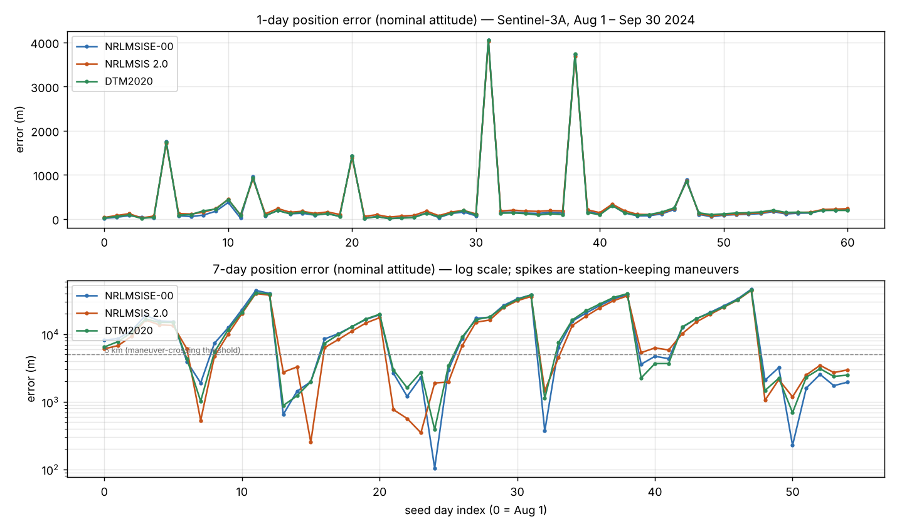

# Density model × measured attitude: a two-month Sentinel-3A propagation study

**Question.** Under URSC's single-state forecast discipline, do two "upgrades" lower the
propagation error for Sentinel-3A (~800 km, sun-synchronous)?

1. **A newer thermosphere density model** — NRLMSIS 2.0 or DTM2020 — instead of the shipped
   NRLMSISE-00.
2. **Using the satellite's measured attitude** (AUX_PROQUA quaternions) in the box-wing drag/SRP
   geometry, instead of the nominal yaw-steering law.

**Answer (measured, two months).** Neither is a win. At the **1-day** horizon NRLMSISE-00 is the
*best* of the three models; at **7-day** the error is dominated by weekly station-keeping maneuvers,
not by the density model, and on maneuver-free windows the three models tie. The measured attitude
changes nothing (<1 m at 1-day, <5 m at 7-day). The real levers are the maneuvers and a fitted drag
coefficient — not the atmosphere-model family or the attitude.

---

## Method

Each prediction is seeded from **one** daily state and uses **only that day's data** (the same
discipline as the earlier before/after study):

| Setting | Value |
|---|---|
| Satellite / period | Sentinel-3A, 2024-08-01 → 2024-10-01 (62 daily first-OSV states) |
| Seed | single ITRF state → GCRF with the **full d*R*/d*t* velocity transform** (central difference) |
| Weather | **forecast-trend** (no future obs): F10.7 relaxes to F10.7a with τ = 4 d; Ap persisted at the seed value |
| Integrator | Dormand-Prince 5(4), **tight** (absTol 1e-10, relTol 1e-12, max step 30 s) |
| Gravity | EGM96 70×70 |
| Drag / SRP | CPOD box-wing geometry, Cd 2.2, mass 1130 kg; + Sun/Moon, SRP, solid+ocean tides, relativity, albedo |
| Attitude | **nominal** = yaw-steering law; **measured** = AUX_PROQUA quaternions (seed day only; nominal law beyond the file's ~1-day coverage, per the "use only the seed day's data" rule) |
| Scoring | propagate to D+1 and D+7, transform GCRF→ITRF, compare to the true daily state |

**Horizons / coverage.** Truth states end Oct 1, so **1-day** rows exist for seeds Aug 1 – Sep 30
(61 days) and **7-day** rows for seeds Aug 1 – Sep 24 (55 days). Measured attitude files were available
for Sep 18 – Oct 2, so the measured-attitude columns are populated only on that overlap; elsewhere they
are blank (and, since measured ≈ nominal, this costs nothing).

Full per-day numbers: [`full_table.pdf`](full_table.pdf) and
[`data/`](data/) (`date,model,attitude,horizon,err_m`). Time series: `graphs/error_timeseries.png`.

## The three density models (and why two are not in the library)

| Model | Role here | Licence | In URSC core? |
|---|---|---|---|
| **NRLMSISE-00** | the shipped model | public domain (US Gov) | **yes** |
| **NRLMSIS 2.0** | newer NRL model, via the official `pymsis` through a subprocess bridge | NRL, **non-commercial / research only** | no — research-only |
| **DTM2020** | CNES model (SWAMI), Java port of the F10.7+Kp variant | CNES, **non-commercial, no redistribution** | no — research-only |

NRLMSIS 2.0 and DTM2020 are both non-commercial-licensed, so they **cannot ship** in URSC and are run
as **scratch experiments only**. Their code and coefficient files are deliberately **not committed** to
this repository (that is why this report contains only *result numbers*, not the engines). All three
were driven from the same forecast-trend F10.7/Ap (DTM2020's Kp derived from daily Ap), so the
comparison is apples-to-apples. NRLMSIS 2.0 (pymsis) was confirmed against NRL's own test vectors, and
the DTM2020 port against the SWAMI reference benchmark (density match ≤ 2×10⁻⁵).

## Results

### Median error (nominal attitude)

| horizon | NRLMSISE-00 | NRLMSIS 2.0 | DTM2020 |
|---|---|---|---|
| 1-day (61 days) | **118 m** | 150 m | 129 m |
| 7-day (55 days) | 10,192 m | **8,352 m** | 9,894 m |

### Which model is lowest each day

| horizon | NRLMSISE-00 | NRLMSIS 2.0 | DTM2020 |
|---|---|---|---|
| 1-day | **36 / 61** | 5 / 61 | 20 / 61 |
| 7-day | 9 / 55 | **42 / 55** | 4 / 55 |

### The 7-day error is maneuver-dominated, not model-dominated

Sentinel-3A performs orbit-control burns roughly weekly. A burn is a near-pure along-track velocity
jump that no density model can predict from a pre-burn state, so any 7-day window crossing one blows
up to 5–46 km. **32 of the 55** seven-day windows are above 5 km for *all three* models — these drive
the ~8–10 km medians above. On the **17 maneuver-free windows** the models are statistically tied:

| 7-day, maneuver-free (17 windows) | NRLMSISE-00 | NRLMSIS 2.0 | DTM2020 |
|---|---|---|---|
| median | 1,904 m | 1,900 m | 1,985 m |

So NRLMSIS 2.0's "42/55" 7-day win-count is it edging the maneuver-swamped windows by small margins;
where the physics is actually clean, swapping the density model buys essentially nothing.

### Measured attitude is negligible

On every day with a measured-attitude file, nominal vs measured differ by **< 1 m at 1-day** and
**< 5 m at 7-day**. The measured yaw-steering attitude is ~2° off the nominal law, which changes the
box-wing projected area by ~0.06 % — far below the drag-error level.

## Conclusions

1. **A newer density model is not automatically better.** At 1-day NRLMSISE-00 wins outright
   (median 118 m vs 129/150 m; best on 36 of 61 days). At 7-day the model choice is washed out by
   maneuvers and ties on clean windows.
2. **The measured attitude does not help** this satellite — the nominal yaw-steering law is already
   within ~2° of truth.
3. **The real limiters are the maneuvers and the fixed drag coefficient**, not the atmosphere-model
   family or the attitude. The productive next levers are (a) ingesting/estimating the station-keeping
   burns, and (b) fitting the ballistic coefficient from an observation arc (needs GNSS OD, not a
   single state).

## Reproduction

Inputs (uploaded, not in the repo): the 62 daily first-OSV states, the AUX_PROQUA attitude files
(Sep 18 – Oct 2), `finals2000A.all` (EOP), `SpaceWeather-All-v1.2.txt`. The run harness and the two
research-only density engines live under the (gitignored) `scratchpad/` and are **not** committed for
the licensing reasons above; the committed `data/*.csv` and `full_table.pdf` are the exact outputs.
URSC core is unchanged by this study apart from a generic `OrbitFiles.Setup.atmosphereOverride`
injection hook (model-agnostic), and the full test suite remains green.
