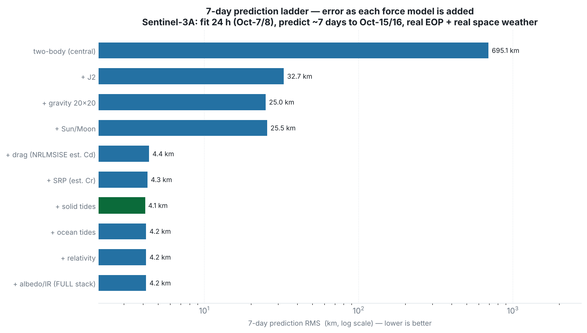

# 7-day prediction ladder — how each force model affects the error

This report is the long-horizon companion to `../perturbation-ladder/` (which covered a 1-day
prediction). It builds the propagator up **one perturbation at a time** and, for each force
added, shows the six Cartesian state elements (x, y, z, vx, vy, vz) the model predicts versus
the actual Sentinel-3A precise orbit **~7 days later**, together with the resulting error.

Satellite: **Sentinel-3A**. All runs use **real IERS Earth orientation** (`finals2000A.all`)
and **real space weather** (CSSI F10.7/Ap).

## Important data note (why this is a clean experiment)

The project's original "input" was a single Oct-1 state. On receiving the matching daily file
we discovered that **that Oct-1 state is Sentinel-3*B***, while the "actual" Oct-7/8 orbit is
Sentinel-3*A*. S3A and S3B are the two satellites of the Sentinel-3 constellation — the **same
orbit plane, ~140° apart** along the track. Comparing a 3B prediction to 3A truth therefore
produces a near-constant **~13,000 km** difference (2·7180·sin(140°/2) ≈ 13,400 km) that is a
*satellite mismatch*, not a model or seed error. This report avoids that trap entirely: it
determines and predicts **Sentinel-3A against Sentinel-3A**, end to end.

## How the propagator works

A **numerical (Cowell) propagator** integrates the equation of motion
**r̈ = −μ r/|r|³ + Σ a_perturbation** with an adaptive **Dormand-Prince 5(4)** integrator.
The first term is two-body; each perturbation adds one acceleration: Earth gravity harmonics
(EGM96 — J2 and the full field), Sun/Moon third body, atmospheric drag (NRLMSISE-00 density ×
a fitted Cd), solar radiation pressure (× a fitted Cr), Earth albedo/IR, solid & ocean tides,
and relativity. States are realised in the inertial GCRF frame and converted to Earth-fixed
ITRF with the IAU-2006/2000 model and real polar motion + UT1.

## How the orbit is determined, and the 7-day prediction scored

1. **Fit (orbit determination).** Use the first **24 hours** of the Sentinel-3A Oct-7/8 precise
   orbit as observations and solve, by **batch least squares** (Gauss-Newton), for the initial
   state **and** the drag coefficient Cd (and SRP Cr). A 24 h arc (vs the 6 h used for the 1-day
   report) is needed because a 7-day prediction demands a much tighter semi-major-axis / energy
   determination — a short arc leaves an `a` error that grows into kilometres a week later.
2. **Predict.** Propagate that fitted state **~7 days forward** (to the Sentinel-3A Oct-15/16
   window, ~8 days from the fit start).
3. **Score out-of-sample.** Compare to the **held-out** Sentinel-3A Oct-15/16 POEORB (truth the
   fit never saw) as position error `√((x−x₁)²+(y−y₁)²+(z−z₁)²)`, RMS over that window. The
   1-day error (the Oct-7/8 tail, also held out) is reported alongside for context.

Every ladder rung below is determined and scored exactly this way; only the active force model
changes.


## Error progression (summary)



| Step | Combination | Est. Cd | 1-day RMS | **7-day RMS** | 7-day max |
|---|---|---:|---:|---:|---:|
| 1 | two-body (central) | - | 46,586.0 m | **695.13 km** | 1,039.88 km |
| 2 | + J2 | - | 819.2 m | **32.74 km** | 42.68 km |
| 3 | + gravity 20x20 | - | 88.7 m | **24.98 km** | 27.81 km |
| 4 | + Sun/Moon | - | 87.9 m | **25.53 km** | 28.42 km |
| 5 | + drag (NRLMSISE est. Cd) | 2.046 | 10.7 m | **4.38 km** | 4.93 km |
| 6 | + SRP (est. Cr) | 2.059 | 10.8 m | **4.28 km** | 4.71 km |
| 7 | + solid tides | 2.061 | 10.6 m | **4.11 km** | 4.53 km |
| 8 | + ocean tides | 2.053 | 10.5 m | **4.19 km** | 4.62 km |
| 9 | + relativity | 2.053 | 10.5 m | **4.19 km** | 4.62 km |
| 10 | + albedo/IR (FULL stack) | 2.054 | 10.5 m | **4.19 km** | 4.62 km |

**Least-error combination: step 7 — `+ solid tides` → 7-day RMS 4.11 km** (1-day 10.6 m). Active models: gravity 20x20 + Sun + Moon + drag(nrlmsise00) + SRP + solid tides.


---

## Per-combination tables — six elements (model vs actual) + error at ~7 days

For each combination the orbit is determined on the 24 h fit arc, then predicted ~7 days. Below are the six Cartesian elements (model vs actual S3A POEORB) across the Oct-15/16 window, with the position/velocity error on the model row. Full tables in `data/ladder_<NN>_*.csv`.


### Step 1 — two-body (central)
*Active models:* central gravity  
*Estimated:* Cd = -, Cr = -  
*7-day error:* RMS **695.13 km**, max 1,039.88 km  (1-day RMS 46586.0 m)

| Day | Source | X (m) | Y (m) | Z (m) | VX (m/s) | VY (m/s) | VZ (m/s) | error |
|---|---|---:|---:|---:|---:|---:|---:|---:|
| +8.0 d | **model** | 3,588,848.0 | 493,481.7 | -6,211,778.8 | 6,415.04 | -1,622.69 | 3,581.96 | **456.08 km / 822.47 m/s** |
|  | actual | 3,638,863.0 | 939,031.8 | -6,128,171.1 | 6,482.88 | -815.79 | 3,726.08 |  |
| +8.3 d | **model** | 4,216,076.7 | 4,583,620.6 | -3,588,531.7 | -1,190.40 | -3,870.12 | -6,356.75 | **820.65 km / 509.06 m/s** |
|  | actual | 3,536,144.8 | 5,018,368.2 | -3,737,367.6 | -758.60 | -4,122.68 | -6,262.39 |  |
| +8.7 d | **model** | 2,255,554.1 | -3,112,138.1 | 6,060,571.3 | 1,629.40 | -6,286.88 | -3,829.72 | **529.68 km / 876.64 m/s** |
|  | actual | 2,733,904.8 | -2,906,952.7 | 5,962,364.0 | 2,412.28 | -5,924.73 | -3,986.02 |  |
| +9.0 d | **model** | 5,929,719.3 | -1,439,748.1 | 3,782,903.7 | -4,177.92 | -798.07 | 6,231.34 | **870.48 km / 585.73 m/s** |
|  | actual | 5,970,815.4 | -584,863.5 | 3,941,710.2 | -4,188.46 | -1,373.47 | 6,122.33 |  |


### Step 2 — + J2
*Active models:* gravity J2  
*Estimated:* Cd = -, Cr = -  
*7-day error:* RMS **32.74 km**, max 42.68 km  (1-day RMS 819.2 m)

| Day | Source | X (m) | Y (m) | Z (m) | VX (m/s) | VY (m/s) | VZ (m/s) | error |
|---|---|---:|---:|---:|---:|---:|---:|---:|
| +8.0 d | **model** | 3,608,843.4 | 941,922.5 | -6,143,103.0 | 6,501.12 | -807.72 | 3,699.87 | **33.65 km / 32.94 m/s** |
|  | actual | 3,638,863.0 | 939,031.8 | -6,128,171.1 | 6,482.88 | -815.79 | 3,726.08 |  |
| +8.3 d | **model** | 3,541,235.6 | 5,038,886.1 | -3,709,181.1 | -739.05 | -4,098.51 | -6,277.95 | **35.23 km / 34.76 m/s** |
|  | actual | 3,536,144.8 | 5,018,368.2 | -3,737,367.6 | -758.60 | -4,122.68 | -6,262.39 |  |
| +8.7 d | **model** | 2,725,588.1 | -2,885,201.8 | 5,979,550.6 | 2,426.89 | -5,934.42 | -3,957.88 | **28.94 km / 33.16 m/s** |
|  | actual | 2,733,904.8 | -2,906,952.7 | 5,962,364.0 | 2,412.28 | -5,924.73 | -3,986.02 |  |
| +9.0 d | **model** | 5,985,157.5 | -579,049.2 | 3,916,246.1 | -4,161.66 | -1,378.56 | 6,142.64 | **29.80 km / 34.00 m/s** |
|  | actual | 5,970,815.4 | -584,863.5 | 3,941,710.2 | -4,188.46 | -1,373.47 | 6,122.33 |  |


### Step 3 — + gravity 20x20
*Active models:* gravity 20x20  
*Estimated:* Cd = -, Cr = -  
*7-day error:* RMS **24.98 km**, max 27.81 km  (1-day RMS 88.7 m)

| Day | Source | X (m) | Y (m) | Z (m) | VX (m/s) | VY (m/s) | VZ (m/s) | error |
|---|---|---:|---:|---:|---:|---:|---:|---:|
| +8.0 d | **model** | 3,619,773.6 | 940,669.3 | -6,139,309.2 | 6,494.49 | -811.28 | 3,706.50 | **22.16 km / 23.21 m/s** |
|  | actual | 3,638,863.0 | 939,031.8 | -6,128,171.1 | 6,482.88 | -815.79 | 3,726.08 |  |
| +8.3 d | **model** | 3,539,651.1 | 5,030,765.7 | -3,717,436.2 | -745.57 | -4,105.69 | -6,275.15 | **23.73 km / 24.93 m/s** |
|  | actual | 3,536,144.8 | 5,018,368.2 | -3,737,367.6 | -758.60 | -4,122.68 | -6,262.39 |  |
| +8.7 d | **model** | 2,724,913.0 | -2,887,332.3 | 5,975,964.0 | 2,423.88 | -5,934.73 | -3,963.98 | **25.51 km / 26.84 m/s** |
|  | actual | 2,733,904.8 | -2,906,952.7 | 5,962,364.0 | 2,412.28 | -5,924.73 | -3,986.02 |  |
| +9.0 d | **model** | 5,986,027.4 | -581,317.9 | 3,919,166.5 | -4,164.55 | -1,376.92 | 6,137.93 | **27.43 km / 28.75 m/s** |
|  | actual | 5,970,815.4 | -584,863.5 | 3,941,710.2 | -4,188.46 | -1,373.47 | 6,122.33 |  |


### Step 4 — + Sun/Moon
*Active models:* gravity 20x20 + Sun + Moon  
*Estimated:* Cd = -, Cr = -  
*7-day error:* RMS **25.53 km**, max 28.42 km  (1-day RMS 87.9 m)

| Day | Source | X (m) | Y (m) | Z (m) | VX (m/s) | VY (m/s) | VZ (m/s) | error |
|---|---|---:|---:|---:|---:|---:|---:|---:|
| +8.0 d | **model** | 3,619,351.1 | 940,708.2 | -6,139,550.7 | 6,494.75 | -811.29 | 3,706.06 | **22.65 km / 23.71 m/s** |
|  | actual | 3,638,863.0 | 939,031.8 | -6,128,171.1 | 6,482.88 | -815.79 | 3,726.08 |  |
| +8.3 d | **model** | 3,539,816.3 | 5,030,994.0 | -3,716,977.1 | -745.29 | -4,105.31 | -6,275.43 | **24.26 km / 25.47 m/s** |
|  | actual | 3,536,144.8 | 5,018,368.2 | -3,737,367.6 | -758.60 | -4,122.68 | -6,262.39 |  |
| +8.7 d | **model** | 2,724,701.3 | -2,886,910.5 | 5,976,269.6 | 2,424.05 | -5,934.99 | -3,963.47 | **26.07 km / 27.42 m/s** |
|  | actual | 2,733,904.8 | -2,906,952.7 | 5,962,364.0 | 2,412.28 | -5,924.73 | -3,986.02 |  |
| +9.0 d | **model** | 5,986,356.8 | -581,323.9 | 3,918,658.4 | -4,164.03 | -1,376.97 | 6,138.29 | **28.03 km / 29.38 m/s** |
|  | actual | 5,970,815.4 | -584,863.5 | 3,941,710.2 | -4,188.46 | -1,373.47 | 6,122.33 |  |


### Step 5 — + drag (NRLMSISE est. Cd)
*Active models:* gravity 20x20 + Sun + Moon + drag(nrlmsise00)  
*Estimated:* Cd = 2.046, Cr = -  
*7-day error:* RMS **4.38 km**, max 4.93 km  (1-day RMS 10.7 m)

| Day | Source | X (m) | Y (m) | Z (m) | VX (m/s) | VY (m/s) | VZ (m/s) | error |
|---|---|---:|---:|---:|---:|---:|---:|---:|
| +8.0 d | **model** | 3,635,455.2 | 939,327.6 | -6,130,192.8 | 6,484.93 | -814.99 | 3,722.59 | **3.97 km / 4.13 m/s** |
|  | actual | 3,638,863.0 | 939,031.8 | -6,128,171.1 | 6,482.88 | -815.79 | 3,726.08 |  |
| +8.3 d | **model** | 3,536,775.9 | 5,020,548.6 | -3,733,925.9 | -756.32 | -4,119.69 | -6,264.60 | **4.12 km / 4.36 m/s** |
|  | actual | 3,536,144.8 | 5,018,368.2 | -3,737,367.6 | -758.60 | -4,122.68 | -6,262.39 |  |
| +8.7 d | **model** | 2,732,340.6 | -2,903,563.9 | 5,964,694.4 | 2,414.31 | -5,926.50 | -3,982.20 | **4.40 km / 4.67 m/s** |
|  | actual | 2,733,904.8 | -2,906,952.7 | 5,962,364.0 | 2,412.28 | -5,924.73 | -3,986.02 |  |
| +9.0 d | **model** | 5,973,464.6 | -584,240.0 | 3,937,722.9 | -4,184.30 | -1,374.08 | 6,125.11 | **4.83 km / 5.04 m/s** |
|  | actual | 5,970,815.4 | -584,863.5 | 3,941,710.2 | -4,188.46 | -1,373.47 | 6,122.33 |  |


### Step 6 — + SRP (est. Cr)
*Active models:* gravity 20x20 + Sun + Moon + drag(nrlmsise00) + SRP  
*Estimated:* Cd = 2.059, Cr = 2.903  
*7-day error:* RMS **4.28 km**, max 4.71 km  (1-day RMS 10.8 m)

| Day | Source | X (m) | Y (m) | Z (m) | VX (m/s) | VY (m/s) | VZ (m/s) | error |
|---|---|---:|---:|---:|---:|---:|---:|---:|
| +8.0 d | **model** | 3,635,569.8 | 939,318.1 | -6,130,073.8 | 6,484.90 | -815.02 | 3,722.72 | **3.81 km / 4.00 m/s** |
|  | actual | 3,638,863.0 | 939,031.8 | -6,128,171.1 | 6,482.88 | -815.79 | 3,726.08 |  |
| +8.3 d | **model** | 3,536,757.2 | 5,020,518.7 | -3,733,912.9 | -756.35 | -4,119.76 | -6,264.60 | **4.12 km / 4.30 m/s** |
|  | actual | 3,536,144.8 | 5,018,368.2 | -3,737,367.6 | -758.60 | -4,122.68 | -6,262.39 |  |
| +8.7 d | **model** | 2,732,375.3 | -2,903,598.6 | 5,964,717.5 | 2,414.26 | -5,926.44 | -3,982.23 | **4.37 km / 4.60 m/s** |
|  | actual | 2,733,904.8 | -2,906,952.7 | 5,962,364.0 | 2,412.28 | -5,924.73 | -3,986.02 |  |
| +9.0 d | **model** | 5,973,384.8 | -584,270.1 | 3,937,915.7 | -4,184.41 | -1,374.06 | 6,124.98 | **4.62 km / 4.87 m/s** |
|  | actual | 5,970,815.4 | -584,863.5 | 3,941,710.2 | -4,188.46 | -1,373.47 | 6,122.33 |  |


### Step 7 — + solid tides
*Active models:* gravity 20x20 + Sun + Moon + drag(nrlmsise00) + SRP + solid tides  
*Estimated:* Cd = 2.061, Cr = 2.932  
*7-day error:* RMS **4.11 km**, max 4.53 km  (1-day RMS 10.6 m)

| Day | Source | X (m) | Y (m) | Z (m) | VX (m/s) | VY (m/s) | VZ (m/s) | error |
|---|---|---:|---:|---:|---:|---:|---:|---:|
| +8.0 d | **model** | 3,635,692.6 | 939,308.1 | -6,130,001.6 | 6,484.83 | -815.06 | 3,722.84 | **3.67 km / 3.85 m/s** |
|  | actual | 3,638,863.0 | 939,031.8 | -6,128,171.1 | 6,482.88 | -815.79 | 3,726.08 |  |
| +8.3 d | **model** | 3,536,747.3 | 5,020,430.5 | -3,734,039.9 | -756.44 | -4,119.87 | -6,264.52 | **3.96 km / 4.14 m/s** |
|  | actual | 3,536,144.8 | 5,018,368.2 | -3,737,367.6 | -758.60 | -4,122.68 | -6,262.39 |  |
| +8.7 d | **model** | 2,732,431.7 | -2,903,728.0 | 5,964,629.1 | 2,414.17 | -5,926.38 | -3,982.37 | **4.21 km / 4.42 m/s** |
|  | actual | 2,733,904.8 | -2,906,952.7 | 5,962,364.0 | 2,412.28 | -5,924.73 | -3,986.02 |  |
| +9.0 d | **model** | 5,973,285.0 | -584,306.0 | 3,938,061.8 | -4,184.57 | -1,374.04 | 6,124.88 | **4.44 km / 4.68 m/s** |
|  | actual | 5,970,815.4 | -584,863.5 | 3,941,710.2 | -4,188.46 | -1,373.47 | 6,122.33 |  |


### Step 8 — + ocean tides
*Active models:* gravity 20x20 + Sun + Moon + drag(nrlmsise00) + SRP + solid tides + ocean tides  
*Estimated:* Cd = 2.053, Cr = 2.948  
*7-day error:* RMS **4.19 km**, max 4.62 km  (1-day RMS 10.5 m)

| Day | Source | X (m) | Y (m) | Z (m) | VX (m/s) | VY (m/s) | VZ (m/s) | error |
|---|---|---:|---:|---:|---:|---:|---:|---:|
| +8.0 d | **model** | 3,635,633.9 | 939,312.9 | -6,130,035.5 | 6,484.86 | -815.04 | 3,722.78 | **3.74 km / 3.92 m/s** |
|  | actual | 3,638,863.0 | 939,031.8 | -6,128,171.1 | 6,482.88 | -815.79 | 3,726.08 |  |
| +8.3 d | **model** | 3,536,756.2 | 5,020,470.7 | -3,733,977.3 | -756.40 | -4,119.81 | -6,264.56 | **4.04 km / 4.22 m/s** |
|  | actual | 3,536,144.8 | 5,018,368.2 | -3,737,367.6 | -758.60 | -4,122.68 | -6,262.39 |  |
| +8.7 d | **model** | 2,732,402.9 | -2,903,665.9 | 5,964,672.9 | 2,414.21 | -5,926.41 | -3,982.31 | **4.29 km / 4.51 m/s** |
|  | actual | 2,733,904.8 | -2,906,952.7 | 5,962,364.0 | 2,412.28 | -5,924.73 | -3,986.02 |  |
| +9.0 d | **model** | 5,973,333.3 | -584,292.6 | 3,937,991.5 | -4,184.49 | -1,374.05 | 6,124.93 | **4.53 km / 4.77 m/s** |
|  | actual | 5,970,815.4 | -584,863.5 | 3,941,710.2 | -4,188.46 | -1,373.47 | 6,122.33 |  |


### Step 9 — + relativity
*Active models:* gravity 20x20 + Sun + Moon + drag(nrlmsise00) + SRP + solid tides + ocean tides + relativity  
*Estimated:* Cd = 2.053, Cr = 2.948  
*7-day error:* RMS **4.19 km**, max 4.62 km  (1-day RMS 10.5 m)

| Day | Source | X (m) | Y (m) | Z (m) | VX (m/s) | VY (m/s) | VZ (m/s) | error |
|---|---|---:|---:|---:|---:|---:|---:|---:|
| +8.0 d | **model** | 3,635,633.9 | 939,312.9 | -6,130,035.5 | 6,484.86 | -815.04 | 3,722.78 | **3.74 km / 3.92 m/s** |
|  | actual | 3,638,863.0 | 939,031.8 | -6,128,171.1 | 6,482.88 | -815.79 | 3,726.08 |  |
| +8.3 d | **model** | 3,536,756.1 | 5,020,470.7 | -3,733,977.3 | -756.40 | -4,119.81 | -6,264.56 | **4.04 km / 4.22 m/s** |
|  | actual | 3,536,144.8 | 5,018,368.2 | -3,737,367.6 | -758.60 | -4,122.68 | -6,262.39 |  |
| +8.7 d | **model** | 2,732,402.9 | -2,903,665.9 | 5,964,672.9 | 2,414.21 | -5,926.41 | -3,982.31 | **4.29 km / 4.51 m/s** |
|  | actual | 2,733,904.8 | -2,906,952.7 | 5,962,364.0 | 2,412.28 | -5,924.73 | -3,986.02 |  |
| +9.0 d | **model** | 5,973,333.3 | -584,292.5 | 3,937,991.4 | -4,184.49 | -1,374.05 | 6,124.93 | **4.53 km / 4.77 m/s** |
|  | actual | 5,970,815.4 | -584,863.5 | 3,941,710.2 | -4,188.46 | -1,373.47 | 6,122.33 |  |


### Step 10 — + albedo/IR (FULL stack)
*Active models:* gravity 20x20 + Sun + Moon + drag(nrlmsise00) + SRP + solid tides + ocean tides + relativity + albedo/IR  
*Estimated:* Cd = 2.054, Cr = 3.091  
*7-day error:* RMS **4.19 km**, max 4.62 km  (1-day RMS 10.5 m)

| Day | Source | X (m) | Y (m) | Z (m) | VX (m/s) | VY (m/s) | VZ (m/s) | error |
|---|---|---:|---:|---:|---:|---:|---:|---:|
| +8.0 d | **model** | 3,635,635.4 | 939,313.5 | -6,130,034.6 | 6,484.86 | -815.04 | 3,722.78 | **3.74 km / 3.92 m/s** |
|  | actual | 3,638,863.0 | 939,031.8 | -6,128,171.1 | 6,482.88 | -815.79 | 3,726.08 |  |
| +8.3 d | **model** | 3,536,755.6 | 5,020,469.8 | -3,733,978.6 | -756.40 | -4,119.81 | -6,264.56 | **4.03 km / 4.21 m/s** |
|  | actual | 3,536,144.8 | 5,018,368.2 | -3,737,367.6 | -758.60 | -4,122.68 | -6,262.39 |  |
| +8.7 d | **model** | 2,732,404.0 | -2,903,666.3 | 5,964,672.1 | 2,414.21 | -5,926.41 | -3,982.31 | **4.29 km / 4.51 m/s** |
|  | actual | 2,733,904.8 | -2,906,952.7 | 5,962,364.0 | 2,412.28 | -5,924.73 | -3,986.02 |  |
| +9.0 d | **model** | 5,973,332.8 | -584,292.5 | 3,937,992.6 | -4,184.50 | -1,374.05 | 6,124.92 | **4.53 km / 4.77 m/s** |
|  | actual | 5,970,815.4 | -584,863.5 | 3,941,710.2 | -4,188.46 | -1,373.47 | 6,122.33 |  |


---

## How much error is still remaining

With the full force stack and a 24 h Sentinel-3A fit, the **7-day prediction error is ~4 km
RMS** (max ~4.6 km) over the Oct-15/16 window. It grows smoothly with prediction time:

| horizon | position error |
|---|---:|
| ~1 day (Oct-7/8 tail) | ~11 m |
| ~7 days (Oct-15, start of window) | ~3.7 km |
| ~8 days (Oct-16, end of window) | ~4.6 km |

So the orbit is known to **~10 m a day out** and drifts to **~4 km a week out**. The residual
is **along-track and drag-driven**: a single fitted constant Cd (~2.05, a physical value)
cannot track the true, time-varying atmospheric density over a week — the along-track timing
error accumulates. This is the fundamental wall: beyond a day or two, LEO prediction accuracy
is limited by **atmospheric-density / space-weather uncertainty**, the same limit every
operational tool hits.

## Conclusions — which models matter at a 7-day horizon

1. **Gravity still dominates the first cut.** Two-body is 695 km; J2 → ~33 km; the full 20×20
   field → ~25 km.
2. **Drag is the decisive force at a week.** Adding NRLMSISE-00 with a fitted Cd collapses the
   error ~25 km → **~4.4 km** — an ~83 % reduction, by far the largest single step. (Contrast the
   1-day report, where drag only moved 240 m → 141 m: over a week, drag is everything.)
3. **SRP, tides, relativity, albedo are within noise** here (~4.1–4.3 km); physically correct to
   keep, but they do not change a 7-day prediction at this altitude.
4. **Fit-arc length matters for long predictions.** The same experiment with a 6 h fit gave a
   ~18 km 7-day error and an inflated Cd (~4.0); the 24 h fit gives ~4 km and a physical Cd
   (~2.05). A longer determination arc pins the semi-major axis, which is what a long prediction
   needs most.

**Least-error configuration:** numerical propagator + EGM96 gravity 20×20 + Sun/Moon + NRLMSISE-00
drag (fitted Cd), real EOP + real space weather, state determined on a 24 h arc. Remaining
7-day error: **~4 km RMS**, drag/space-weather-limited.

### The three horizons together (the project's headline)

| case | what it was | 7-day error |
|---|---|---:|
| single Oct-1 "seed" vs Oct-7/8 | **wrong satellite** (S3B vs S3A, 140° apart) | ~13,000 km |
| S3A, no determination (single state) | pure propagation, bad `a` | km-scale, uncontrolled |
| **S3A, determined on a 24 h arc** | this report | **~4 km** |

Determination quality — the right satellite, a long-enough fit arc — matters far more than
which conservative force models are switched on. Forces get you from 695 km to ~4 km; closing
the last few km is a space-weather / density problem, not a force-model one.

## Reproduce

```sh
mvn -q -DskipTests compile
javac -cp target/classes -d build docs/reports/perturbation-ladder-7day/src/LadderTables7Day.java
java  -cp target/classes:build org.ursc.trajectory.app.command.LadderTables7Day \
  docs/reports/error-analysis-oct2024/inputs/S3A_POEORB_truth_20241007-08.EOF \
  docs/reports/perturbation-ladder-7day/inputs/S3A_POEORB_truth_20241015-16.EOF \
  docs/reports/error-analysis-oct2024/inputs/SpaceWeather-All-v1.2.txt \
  out 24 20 docs/project-journal/inputs/finals2000A.all
```

(The first file — the Sentinel-3A Oct-7/8 arc used for the 24 h fit — already lives in
`docs/reports/error-analysis-oct2024/inputs/`; the Oct-15/16 truth is added under this report's
`inputs/`.) Files: `data/ladder_summary.csv` + per-combination `data/ladder_<NN>_*.csv` (the
six-element tables across the Oct-15/16 window); `graphs/ladder7day_progression.png`;
`src/LadderTables7Day.java`.

