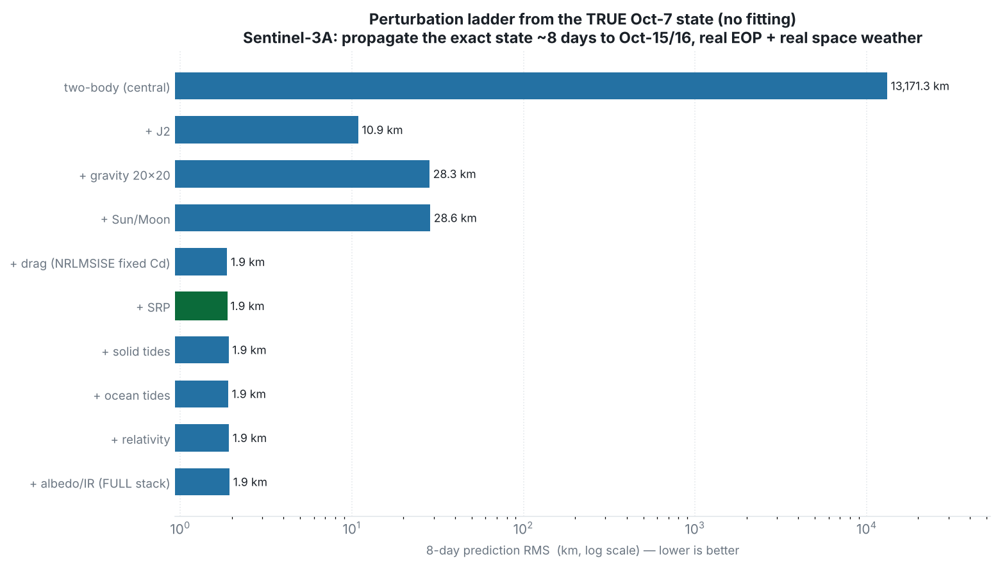

# Perturbation ladder from the true state — how each model reduces the error (7–8 day prediction)

This report starts from the **exact true Sentinel-3A state at 2024-10-07 21:59:42** and, adding
one perturbation at a time, propagates it ~7–8 days forward and compares the six Cartesian state
elements (x, y, z, vx, vy, vz) to the actual Sentinel-3A orbit on 2024-10-15/16. Because the
initial state is the *truth* (confirmed exactly against the Oct-15 POEORB), the error at each rung
is the **pure contribution of the force models** — there is no initial-state or fit error mixed in.

Satellite **Sentinel-3A**. **Real IERS Earth orientation** (`finals2000A.all`) and **real space
weather** (CSSI F10.7/Ap). This is the complement to the fit-based report in
`../perturbation-ladder-7day/`: there the state was *determined* from a 24 h arc; here it is the
*exact true state*, with **no fitting** (a single state cannot be fitted), and drag therefore uses
a **fixed** Cd = 2.2 (not estimated).

## How the propagator works

A **numerical (Cowell) propagator** integrates **r̈ = −μ r/|r|³ + Σ a_perturbation** with an
adaptive **Dormand-Prince 5(4)** integrator. Two-body is the central term; each perturbation adds
one acceleration — Earth gravity harmonics (EGM96: J2 and the full field), Sun/Moon third body,
atmospheric drag (NRLMSISE-00 density × a fixed Cd), solar radiation pressure, Earth albedo/IR,
solid & ocean tides, relativity. States are inertial GCRF, converted to Earth-fixed ITRF with the
IAU-2006/2000 model and real polar motion + UT1.

## Method (no orbit determination)

1. **Seed** the propagator with the exact true Oct-7 state (no fitting).
2. **Add one force**, propagate ~7–8 days to the Oct-15/16 window.
3. **Compare** to the actual S3A POEORB: position error `√((x−x₁)²+(y−y₁)²+(z−z₁)²)` (and velocity),
   RMS over the Oct-15/16 (~8-day) window; the Oct-7/8 (~1-day) error is reported alongside.

## The two-body baseline (confirmed with the user)

With **nothing but two-body**, even from the exact true state, the prediction is off by
**≈ 1,228 km after 1 day** and **≈ 13,171 km after 8 days** — because two-body omits J2, the
Earth's flattening, which drives the ~1°/day sun-synchronous nodal precession and the dominant
short/long-period motion. The ladder below shows how each added model pulls that error down.


## Error progression (summary)



| Step | Combination | 1-day RMS | **8-day RMS** | 8-day max |
|---|---|---:|---:|---:|
| 1 | two-body (central) | 1,228.21 km | **13,171.32 km** | 13,592.63 km |
| 2 | + J2 | 1.27 km | **10.89 km** | 18.50 km |
| 3 | + gravity 20x20 | 197.3 m | **28.32 km** | 31.37 km |
| 4 | + Sun/Moon | 177.3 m | **28.59 km** | 31.68 km |
| 5 | + drag (NRLMSISE fixed Cd) | 77.9 m | **1.87 km** | 2.21 km |
| 6 | + SRP | 79.2 m | **1.86 km** | 2.14 km |
| 7 | + solid tides | 65.1 m | **1.91 km** | 2.18 km |
| 8 | + ocean tides | 66.0 m | **1.90 km** | 2.17 km |
| 9 | + relativity | 64.5 m | **1.92 km** | 2.19 km |
| 10 | + albedo/IR (FULL stack) | 63.7 m | **1.94 km** | 2.21 km |

**Least-error combination: step 6 — `+ SRP` → 8-day RMS 1.86 km** (1-day 79.2 m). Active models: gravity 20x20 + Sun + Moon + drag(nrlmsise00) + SRP.


---

## Per-combination tables — six elements (model vs actual) + error at ~7–8 days

Pure propagation of the TRUE Oct-7 state with the force set shown. Six Cartesian elements (model vs actual S3A POEORB) across the Oct-15/16 window; error on the model row. Full tables in `data/ladder_<NN>_*.csv`.


### Step 1 — two-body (central)
*Active models:* central gravity  
*8-day error:* RMS **13,171.32 km**, max 13,592.63 km  (1-day RMS 1,228.21 km)

| Day | Source | X (m) | Y (m) | Z (m) | VX (m/s) | VY (m/s) | VZ (m/s) | error |
|---|---|---:|---:|---:|---:|---:|---:|---:|
| +8.0 d | **model** | 2,933,662.0 | -1,376,586.4 | 6,375,550.8 | -6,848.01 | 216.50 | 3,186.23 | **12735.87 km / 13381.69 m/s** |
|  | actual | 3,638,863.0 | 939,031.8 | -6,128,171.1 | 6,482.88 | -815.79 | 3,726.08 |  |
| +8.3 d | **model** | -3,890,689.8 | -5,547,610.1 | -2,365,764.5 | -2,755.80 | -1,006.06 | 6,948.69 | **12987.65 km / 13719.87 m/s** |
|  | actual | 3,536,144.8 | 5,018,368.2 | -3,737,367.6 | -758.60 | -4,122.68 | -6,262.39 |  |
| +8.7 d | **model** | -391,964.8 | -1,869,471.7 | -6,929,648.1 | -3,035.13 | 6,678.77 | -1,636.43 | **13306.07 km / 13929.94 m/s** |
|  | actual | 2,733,904.8 | -2,906,952.7 | 5,962,364.0 | 2,412.28 | -5,924.73 | -3,986.02 |  |
| +9.0 d | **model** | -7,057,167.0 | 965,098.4 | 779,458.3 | -591.81 | 1,742.45 | -7,328.81 | **13495.57 km / 14268.08 m/s** |
|  | actual | 5,970,815.4 | -584,863.5 | 3,941,710.2 | -4,188.46 | -1,373.47 | 6,122.33 |  |


### Step 2 — + J2
*Active models:* gravity J2  
*8-day error:* RMS **10.89 km**, max 18.50 km  (1-day RMS 1.27 km)

| Day | Source | X (m) | Y (m) | Z (m) | VX (m/s) | VY (m/s) | VZ (m/s) | error |
|---|---|---:|---:|---:|---:|---:|---:|---:|
| +8.0 d | **model** | 3,627,224.8 | 940,739.5 | -6,132,338.7 | 6,489.96 | -811.79 | 3,718.88 | **12.48 km / 10.86 m/s** |
|  | actual | 3,638,863.0 | 939,031.8 | -6,128,171.1 | 6,482.88 | -815.79 | 3,726.08 |  |
| +8.3 d | **model** | 3,537,789.7 | 5,027,482.4 | -3,728,013.7 | -750.90 | -4,114.64 | -6,265.83 | **13.16 km / 11.65 m/s** |
|  | actual | 3,536,144.8 | 5,018,368.2 | -3,737,367.6 | -758.60 | -4,122.68 | -6,262.39 |  |
| +8.7 d | **model** | 2,734,267.7 | -2,903,098.4 | 5,967,006.7 | 2,416.49 | -5,925.14 | -3,978.12 | **6.04 km / 8.96 m/s** |
|  | actual | 2,733,904.8 | -2,906,952.7 | 5,962,364.0 | 2,412.28 | -5,924.73 | -3,986.02 |  |
| +9.0 d | **model** | 5,971,537.8 | -581,962.6 | 3,936,343.7 | -4,182.99 | -1,375.97 | 6,128.76 | **6.14 km / 8.80 m/s** |
|  | actual | 5,970,815.4 | -584,863.5 | 3,941,710.2 | -4,188.46 | -1,373.47 | 6,122.33 |  |


### Step 3 — + gravity 20x20
*Active models:* gravity 20x20  
*8-day error:* RMS **28.32 km**, max 31.37 km  (1-day RMS 197.3 m)

| Day | Source | X (m) | Y (m) | Z (m) | VX (m/s) | VY (m/s) | VZ (m/s) | error |
|---|---|---:|---:|---:|---:|---:|---:|---:|
| +8.0 d | **model** | 3,617,064.2 | 940,917.6 | -6,140,874.0 | 6,496.14 | -810.65 | 3,703.73 | **25.30 km / 26.49 m/s** |
|  | actual | 3,638,863.0 | 939,031.8 | -6,128,171.1 | 6,482.88 | -815.79 | 3,726.08 |  |
| +8.3 d | **model** | 3,540,135.5 | 5,032,460.3 | -3,714,695.5 | -743.76 | -4,103.36 | -6,276.89 | **26.99 km / 28.35 m/s** |
|  | actual | 3,536,144.8 | 5,018,368.2 | -3,737,367.6 | -758.60 | -4,122.68 | -6,262.39 |  |
| +8.7 d | **model** | 2,723,732.0 | -2,884,718.6 | 5,977,762.7 | 2,425.41 | -5,936.05 | -3,961.04 | **28.90 km / 30.40 m/s** |
|  | actual | 2,733,904.8 | -2,906,952.7 | 5,962,364.0 | 2,412.28 | -5,924.73 | -3,986.02 |  |
| +9.0 d | **model** | 5,987,978.5 | -580,863.3 | 3,916,253.5 | -4,161.47 | -1,377.38 | 6,139.94 | **30.96 km / 32.46 m/s** |
|  | actual | 5,970,815.4 | -584,863.5 | 3,941,710.2 | -4,188.46 | -1,373.47 | 6,122.33 |  |


### Step 4 — + Sun/Moon
*Active models:* gravity 20x20 + Sun + Moon  
*8-day error:* RMS **28.59 km**, max 31.68 km  (1-day RMS 177.3 m)

| Day | Source | X (m) | Y (m) | Z (m) | VX (m/s) | VY (m/s) | VZ (m/s) | error |
|---|---|---:|---:|---:|---:|---:|---:|---:|
| +8.0 d | **model** | 3,616,871.2 | 940,919.3 | -6,140,984.8 | 6,496.25 | -810.72 | 3,703.52 | **25.52 km / 26.71 m/s** |
|  | actual | 3,638,863.0 | 939,031.8 | -6,128,171.1 | 6,482.88 | -815.79 | 3,726.08 |  |
| +8.3 d | **model** | 3,540,269.2 | 5,032,539.8 | -3,714,467.8 | -743.65 | -4,103.18 | -6,277.03 | **27.24 km / 28.60 m/s** |
|  | actual | 3,536,144.8 | 5,018,368.2 | -3,737,367.6 | -758.60 | -4,122.68 | -6,262.39 |  |
| +8.7 d | **model** | 2,723,606.9 | -2,884,529.0 | 5,977,917.1 | 2,425.44 | -5,936.20 | -3,960.79 | **29.17 km / 30.68 m/s** |
|  | actual | 2,733,904.8 | -2,906,952.7 | 5,962,364.0 | 2,412.28 | -5,924.73 | -3,986.02 |  |
| +9.0 d | **model** | 5,988,140.8 | -580,918.7 | 3,915,991.8 | -4,161.21 | -1,377.37 | 6,140.13 | **31.26 km / 32.77 m/s** |
|  | actual | 5,970,815.4 | -584,863.5 | 3,941,710.2 | -4,188.46 | -1,373.47 | 6,122.33 |  |


### Step 5 — + drag (NRLMSISE fixed Cd)
*Active models:* gravity 20x20 + Sun + Moon + drag(nrlmsise00)  
*8-day error:* RMS **1.87 km**, max 2.21 km  (1-day RMS 77.9 m)

| Day | Source | X (m) | Y (m) | Z (m) | VX (m/s) | VY (m/s) | VZ (m/s) | error |
|---|---|---:|---:|---:|---:|---:|---:|---:|
| +8.0 d | **model** | 3,637,395.5 | 939,160.5 | -6,129,063.2 | 6,483.74 | -815.43 | 3,724.58 | **1.72 km / 1.76 m/s** |
|  | actual | 3,638,863.0 | 939,031.8 | -6,128,171.1 | 6,482.88 | -815.79 | 3,726.08 |  |
| +8.3 d | **model** | 3,536,415.7 | 5,019,299.0 | -3,735,955.6 | -757.64 | -4,121.41 | -6,263.29 | **1.71 km / 1.83 m/s** |
|  | actual | 3,536,144.8 | 5,018,368.2 | -3,737,367.6 | -758.60 | -4,122.68 | -6,262.39 |  |
| +8.7 d | **model** | 2,733,246.2 | -2,905,540.7 | 5,963,316.2 | 2,413.15 | -5,925.49 | -3,984.42 | **1.83 km / 1.97 m/s** |
|  | actual | 2,733,904.8 | -2,906,952.7 | 5,962,364.0 | 2,412.28 | -5,924.73 | -3,986.02 |  |
| +9.0 d | **model** | 5,971,948.5 | -584,582.8 | 3,939,946.1 | -4,186.67 | -1,373.74 | 6,123.57 | **2.12 km / 2.19 m/s** |
|  | actual | 5,970,815.4 | -584,863.5 | 3,941,710.2 | -4,188.46 | -1,373.47 | 6,122.33 |  |


### Step 6 — + SRP
*Active models:* gravity 20x20 + Sun + Moon + drag(nrlmsise00) + SRP  
*8-day error:* RMS **1.86 km**, max 2.14 km  (1-day RMS 79.2 m)

| Day | Source | X (m) | Y (m) | Z (m) | VX (m/s) | VY (m/s) | VZ (m/s) | error |
|---|---|---:|---:|---:|---:|---:|---:|---:|
| +8.0 d | **model** | 3,637,420.2 | 939,158.7 | -6,129,024.2 | 6,483.74 | -815.44 | 3,724.61 | **1.68 km / 1.74 m/s** |
|  | actual | 3,638,863.0 | 939,031.8 | -6,128,171.1 | 6,482.88 | -815.79 | 3,726.08 |  |
| +8.3 d | **model** | 3,536,412.5 | 5,019,304.5 | -3,735,917.0 | -757.64 | -4,121.41 | -6,263.31 | **1.75 km / 1.84 m/s** |
|  | actual | 3,536,144.8 | 5,018,368.2 | -3,737,367.6 | -758.60 | -4,122.68 | -6,262.39 |  |
| +8.7 d | **model** | 2,733,247.3 | -2,905,523.8 | 5,963,350.0 | 2,413.14 | -5,925.48 | -3,984.40 | **1.86 km / 1.98 m/s** |
|  | actual | 2,733,904.8 | -2,906,952.7 | 5,962,364.0 | 2,412.28 | -5,924.73 | -3,986.02 |  |
| +9.0 d | **model** | 5,971,937.1 | -584,591.1 | 3,939,999.1 | -4,186.68 | -1,373.74 | 6,123.53 | **2.06 km / 2.16 m/s** |
|  | actual | 5,970,815.4 | -584,863.5 | 3,941,710.2 | -4,188.46 | -1,373.47 | 6,122.33 |  |


### Step 7 — + solid tides
*Active models:* gravity 20x20 + Sun + Moon + drag(nrlmsise00) + SRP + solid tides  
*8-day error:* RMS **1.91 km**, max 2.18 km  (1-day RMS 65.1 m)

| Day | Source | X (m) | Y (m) | Z (m) | VX (m/s) | VY (m/s) | VZ (m/s) | error |
|---|---|---:|---:|---:|---:|---:|---:|---:|
| +8.0 d | **model** | 3,637,373.4 | 939,160.3 | -6,129,051.6 | 6,483.77 | -815.45 | 3,724.56 | **1.74 km / 1.79 m/s** |
|  | actual | 3,638,863.0 | 939,031.8 | -6,128,171.1 | 6,482.88 | -815.79 | 3,726.08 |  |
| +8.3 d | **model** | 3,536,435.3 | 5,019,321.9 | -3,735,871.7 | -757.61 | -4,121.37 | -6,263.34 | **1.80 km / 1.89 m/s** |
|  | actual | 3,536,144.8 | 5,018,368.2 | -3,737,367.6 | -758.60 | -4,122.68 | -6,262.39 |  |
| +8.7 d | **model** | 2,733,225.6 | -2,905,490.4 | 5,963,376.1 | 2,413.15 | -5,925.50 | -3,984.35 | **1.90 km / 2.03 m/s** |
|  | actual | 2,733,904.8 | -2,906,952.7 | 5,962,364.0 | 2,412.28 | -5,924.73 | -3,986.02 |  |
| +9.0 d | **model** | 5,971,961.7 | -584,600.7 | 3,939,960.8 | -4,186.64 | -1,373.74 | 6,123.56 | **2.11 km / 2.20 m/s** |
|  | actual | 5,970,815.4 | -584,863.5 | 3,941,710.2 | -4,188.46 | -1,373.47 | 6,122.33 |  |


### Step 8 — + ocean tides
*Active models:* gravity 20x20 + Sun + Moon + drag(nrlmsise00) + SRP + solid tides + ocean tides  
*8-day error:* RMS **1.90 km**, max 2.17 km  (1-day RMS 66.0 m)

| Day | Source | X (m) | Y (m) | Z (m) | VX (m/s) | VY (m/s) | VZ (m/s) | error |
|---|---|---:|---:|---:|---:|---:|---:|---:|
| +8.0 d | **model** | 3,637,383.4 | 939,159.6 | -6,129,045.7 | 6,483.76 | -815.45 | 3,724.57 | **1.72 km / 1.78 m/s** |
|  | actual | 3,638,863.0 | 939,031.8 | -6,128,171.1 | 6,482.88 | -815.79 | 3,726.08 |  |
| +8.3 d | **model** | 3,536,431.0 | 5,019,317.4 | -3,735,881.9 | -757.62 | -4,121.38 | -6,263.34 | **1.79 km / 1.88 m/s** |
|  | actual | 3,536,144.8 | 5,018,368.2 | -3,737,367.6 | -758.60 | -4,122.68 | -6,262.39 |  |
| +8.7 d | **model** | 2,733,229.5 | -2,905,499.0 | 5,963,370.1 | 2,413.15 | -5,925.50 | -3,984.36 | **1.89 km / 2.02 m/s** |
|  | actual | 2,733,904.8 | -2,906,952.7 | 5,962,364.0 | 2,412.28 | -5,924.73 | -3,986.02 |  |
| +9.0 d | **model** | 5,971,955.5 | -584,599.3 | 3,939,970.4 | -4,186.65 | -1,373.73 | 6,123.55 | **2.10 km / 2.19 m/s** |
|  | actual | 5,970,815.4 | -584,863.5 | 3,941,710.2 | -4,188.46 | -1,373.47 | 6,122.33 |  |


### Step 9 — + relativity
*Active models:* gravity 20x20 + Sun + Moon + drag(nrlmsise00) + SRP + solid tides + ocean tides + relativity  
*8-day error:* RMS **1.92 km**, max 2.19 km  (1-day RMS 64.5 m)

| Day | Source | X (m) | Y (m) | Z (m) | VX (m/s) | VY (m/s) | VZ (m/s) | error |
|---|---|---:|---:|---:|---:|---:|---:|---:|
| +8.0 d | **model** | 3,637,367.1 | 939,161.0 | -6,129,055.2 | 6,483.77 | -815.45 | 3,724.56 | **1.74 km / 1.80 m/s** |
|  | actual | 3,638,863.0 | 939,031.8 | -6,128,171.1 | 6,482.88 | -815.79 | 3,726.08 |  |
| +8.3 d | **model** | 3,536,433.9 | 5,019,327.7 | -3,735,865.3 | -757.61 | -4,121.37 | -6,263.35 | **1.81 km / 1.90 m/s** |
|  | actual | 3,536,144.8 | 5,018,368.2 | -3,737,367.6 | -758.60 | -4,122.68 | -6,262.39 |  |
| +8.7 d | **model** | 2,733,222.3 | -2,905,483.2 | 5,963,381.2 | 2,413.16 | -5,925.51 | -3,984.35 | **1.91 km / 2.04 m/s** |
|  | actual | 2,733,904.8 | -2,906,952.7 | 5,962,364.0 | 2,412.28 | -5,924.73 | -3,986.02 |  |
| +9.0 d | **model** | 5,971,967.4 | -584,596.5 | 3,939,952.8 | -4,186.64 | -1,373.74 | 6,123.56 | **2.12 km / 2.21 m/s** |
|  | actual | 5,970,815.4 | -584,863.5 | 3,941,710.2 | -4,188.46 | -1,373.47 | 6,122.33 |  |


### Step 10 — + albedo/IR (FULL stack)
*Active models:* gravity 20x20 + Sun + Moon + drag(nrlmsise00) + SRP + solid tides + ocean tides + relativity + albedo/IR  
*8-day error:* RMS **1.94 km**, max 2.21 km  (1-day RMS 63.7 m)

| Day | Source | X (m) | Y (m) | Z (m) | VX (m/s) | VY (m/s) | VZ (m/s) | error |
|---|---|---:|---:|---:|---:|---:|---:|---:|
| +8.0 d | **model** | 3,637,355.2 | 939,162.4 | -6,129,063.3 | 6,483.78 | -815.44 | 3,724.54 | **1.76 km / 1.81 m/s** |
|  | actual | 3,638,863.0 | 939,031.8 | -6,128,171.1 | 6,482.88 | -815.79 | 3,726.08 |  |
| +8.3 d | **model** | 3,536,435.9 | 5,019,334.4 | -3,735,855.9 | -757.60 | -4,121.36 | -6,263.35 | **1.82 km / 1.92 m/s** |
|  | actual | 3,536,144.8 | 5,018,368.2 | -3,737,367.6 | -758.60 | -4,122.68 | -6,262.39 |  |
| +8.7 d | **model** | 2,733,217.5 | -2,905,472.8 | 5,963,387.1 | 2,413.16 | -5,925.51 | -3,984.33 | **1.93 km / 2.06 m/s** |
|  | actual | 2,733,904.8 | -2,906,952.7 | 5,962,364.0 | 2,412.28 | -5,924.73 | -3,986.02 |  |
| +9.0 d | **model** | 5,971,976.3 | -584,594.2 | 3,939,938.2 | -4,186.62 | -1,373.74 | 6,123.57 | **2.14 km / 2.23 m/s** |
|  | actual | 5,970,815.4 | -584,863.5 | 3,941,710.2 | -4,188.46 | -1,373.47 | 6,122.33 |  |


---

## How much error is still remaining

With the **full force stack from the true state** (fixed Cd), the ~7–8-day prediction is
**≈ 1.9 km RMS** (the full model predicts the Oct-15 state to **1.76 km**), versus **12,736 km**
for two-body. It grows with time: **~64 m at 1 day → ~1.9 km at 8 days**, along-track and
drag-driven. The residual is set by the **fixed** drag coefficient: a single constant Cd cannot
track the true, time-varying density over a week, so an along-track timing error accumulates. This
is the fundamental space-weather / density wall.

## Conclusions — which models matter (true-state, 7–8 day)

1. **J2 is the first and biggest fix.** Two-body 13,171 km → +J2 10.9 km: the Earth's flattening
   is what dephases a two-body orbit, so adding it alone removes ~99.9 % of the error.
2. **Drag is the decisive force at a week.** Adding NRLMSISE-00 drag collapses the error to
   **~1.9 km** — the single step that takes the ladder from tens of km to ~2 km.
3. **SRP, tides, relativity, albedo are within noise** here (~1.9 km, metre-level 1-day changes);
   physically correct to keep, but they do not change a 7–8-day prediction at this altitude.
4. **An honest wrinkle at 8 days (the "+ gravity 20×20" rung).** On the 8-day metric, +gravity
   (28 km) looks *worse* than +J2 (10.9 km). This is a cumulative-ladder artifact: at this rung
   drag is still **off**, so the orbit does not decay while the real one does; the full gravity
   field is correct but the missing-drag error now dominates, whereas J2-only happens to *cancel*
   part of that drag error (a coincidence, not a physical win). As soon as drag is switched on
   (next rung) the error drops cleanly to ~1.9 km and the full model is best. The 1-day metric,
   where drag is small, stays cleanly monotonic (1,228 km → 1.3 km → 197 m → … → 64 m).

### True state vs. a 24 h-fitted state (the two 7-day reports side by side)

| horizon | fitted (24 h arc) | **true state (no fit)** |
|---|---:|---:|
| 1 day | 10.5 m | 64 m |
| 7–8 days | ~4.2 km | **~1.9 km** |

The exact true state wins at a week (no initial-state bias), while the fit wins at 1 day (it tunes
state + Cd to the near-term data). Both confirm the same thing: with the right physics the 7-day
error is **km-scale**, and the last few km are a drag / space-weather limit, not a force-model one.

### The whole journey (two-body → full model, from the true Oct-7 state)

| model | 8-day error |
|---|---:|
| two-body | 13,171 km |
| + J2 | 10.9 km |
| + gravity + Sun/Moon | ~28 km (drag still off — see note) |
| **+ drag → full stack** | **~1.9 km** |

## Reproduce

```sh
mvn -q -DskipTests compile
javac -cp target/classes -d build docs/reports/perturbation-ladder-truestate-7day/src/LadderTrueState.java
java  -cp target/classes:build org.ursc.trajectory.app.command.LadderTrueState \
  docs/reports/error-analysis-oct2024/inputs/S3A_POEORB_truth_20241007-08.EOF \
  docs/reports/perturbation-ladder-7day/inputs/S3A_POEORB_truth_20241015-16.EOF \
  docs/reports/error-analysis-oct2024/inputs/SpaceWeather-All-v1.2.txt \
  out 20 docs/project-journal/inputs/finals2000A.all
```

Files: `data/ladder_summary.csv` + per-combination `data/ladder_<NN>_*.csv`;
`graphs/ladder_truestate_progression.png`; `src/LadderTrueState.java`.

