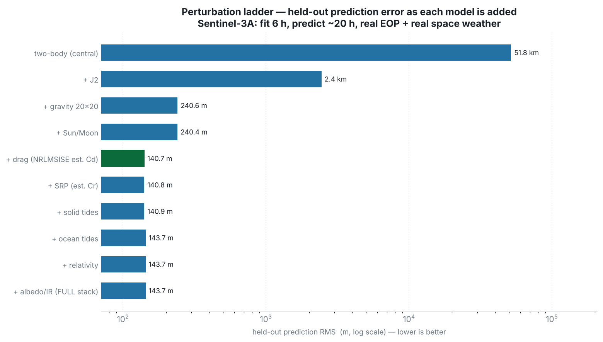

# Perturbation ladder — how each force model affects the error

This report builds the propagator up **one perturbation at a time**, starting from a bare
two-body model, and for every force added it shows the six Cartesian state elements
(x, y, z, vx, vy, vz) the model predicts versus the actual Sentinel-3A precise orbit, together
with the resulting error. It is step-by-step proof of **which models are used and how each one
changes the error rate**, ending at the least-error combination and the error that still
remains.

Satellite: **Sentinel-3A** (~800 km, sun-synchronous). Truth: the real **POEORB** precise
orbit for **2024-10-07/08** (9361 states at 10 s). All runs use **real IERS Earth orientation**
(`finals2000A.all`) and **real space weather** (CSSI F10.7/Ap).

## How the propagator works

The core is a **numerical (Cowell) propagator**: it integrates the satellite's equation of
motion directly,

&nbsp;&nbsp;&nbsp;&nbsp;**r̈ = −μ r / |r|³ + Σ a_perturbation**,

with an adaptive **Dormand-Prince 5(4)** Runge-Kutta integrator. The first term is two-body
(point-mass Earth); each perturbation adds one acceleration term:

- **Gravity harmonics** (EGM96): the non-spherical Earth — J2 (the flattening, the dominant
  LEO perturbation) and the full degree/order field.
- **Sun/Moon third body**: the gravitational pull of the Sun and Moon.
- **Atmospheric drag** (NRLMSISE-00 density × a fitted drag coefficient Cd): the main
  non-conservative force at this altitude.
- **Solar radiation pressure** (× a fitted reflectivity Cr), **Earth albedo/IR**,
  **solid & ocean tides**, and **relativity** (Schwarzschild + Lense-Thirring).

Positions are realised in the inertial **GCRF** frame and converted to the Earth-fixed **ITRF**
for comparison using the **IAU-2006/2000** precession-nutation model with real polar motion and
UT1 from the IERS file.

## How the orbit is determined (and the error measured)

A propagator needs a starting state. We **determine** it from data rather than assume it:

1. **Fit (orbit determination).** Take the first **6 hours** of the real precise orbit as
   observations and solve, by **batch least squares** (Gauss-Newton with a finite-difference
   Jacobian), for the initial state **and** the drag coefficient Cd (and SRP Cr when SRP is on)
   that best reproduce those 6 hours under the chosen force model.
2. **Predict.** Propagate that fitted state forward over the next **~20 hours**.
3. **Score out-of-sample.** Compare the prediction to the **held-out** truth it never saw, as
   position error `√((x−x₁)²+(y−y₁)²+(z−z₁)²)` (and the same on velocity), reported as RMS over
   the held-out span. Because scoring is on data the fit never touched, a model cannot win by
   over-fitting the training arc — this is a fair test of *prediction* quality.

Every rung of the ladder below is determined and scored exactly this way; only the active force
model changes.


## Error-rate progression (summary)



| Step | Combination (models added so far) | Est. Cd | Est. Cr | Held-out RMS | Max | Final |
|---|---|---:|---:|---:|---:|---:|
| 1 | two-body (central) | - | - | **51,818.9 m** | 115,818 | 30,655 |
| 2 | + J2 | - | - | **2,446.1 m** (-49372.8 m) | 4,235 | 3,759 |
| 3 | + gravity 20x20 | - | - | **240.6 m** (-2205.5 m) | 477 | 476 |
| 4 | + Sun/Moon | - | - | **240.4 m** (-0.2 m) | 476 | 474 |
| 5 | + drag (NRLMSISE est. Cd) | 3.978 | - | **140.7 m** (-99.7 m) | 324 | 324 |
| 6 | + SRP (est. Cr) | 3.984 | 0.557 | **140.8 m** (+0.1 m) | 325 | 325 |
| 7 | + solid tides | 3.988 | 0.611 | **140.9 m** (+0.1 m) | 326 | 326 |
| 8 | + ocean tides | 4.017 | 0.646 | **143.7 m** (+2.8 m) | 332 | 332 |
| 9 | + relativity | 4.017 | 0.647 | **143.7 m** (-0.0 m) | 332 | 332 |
| 10 | + albedo/IR (FULL stack) | 4.018 | 0.695 | **143.7 m** (+0.0 m) | 332 | 332 |

**Least-error combination: step 5 — `+ drag (NRLMSISE est. Cd)` → held-out RMS 140.7 m.** Active models: gravity 20x20 + Sun + Moon + drag(nrlmsise00).


---

## Per-combination tables — six elements (model vs actual) + error

For each combination the orbit is re-determined on the 6 h fit arc, then predicted; below are the six Cartesian elements of the model vs the actual POEORB at +4/8/12/16/20 h into the prediction, with the position/velocity error on the model row. Full hourly rows are in `data/ladder_<NN>_*.csv`.


### Step 1 — two-body (central)
*Active models:* central gravity  
*Estimated:* Cd = -, Cr = -  
*Held-out error:* RMS **51,818.9 m**, max 115,817.7 m, final 30,654.6 m

| Hour | Source | X (m) | Y (m) | Z (m) | VX (m/s) | VY (m/s) | VZ (m/s) | error |
|---|---|---:|---:|---:|---:|---:|---:|---:|
| +4 h | **model** | 2,360,776.7 | 166,108.6 | -6,790,907.6 | -5,986.984 | -3,995.242 | -2,182.011 | **10,926.1 m / 35.877 m/s** |
|  | actual | 2,357,017.4 | 176,225.3 | -6,789,205.0 | -5,965.236 | -4,023.174 | -2,176.179 |  |
| +8 h | **model** | -5,208,535.4 | 3,635,161.3 | 3,347,931.3 | 3,802.572 | -547.576 | 6,493.856 | **49,383.3 m / 27.127 m/s** |
|  | actual | -5,233,319.1 | 3,592,815.0 | 3,353,523.3 | 3,813.473 | -523.064 | 6,489.836 |  |
| +12 h | **model** | 239,677.1 | -6,902,352.8 | 1,966,690.5 | -1,594.945 | -2,080.270 | -7,076.736 | **73,865.8 m / 26.142 m/s** |
|  | actual | 313,229.4 | -6,901,347.0 | 1,959,966.2 | -1,571.724 | -2,091.965 | -7,079.462 |  |
| +16 h | **model** | 2,602,892.1 | 2,543,382.7 | -6,202,149.3 | 6,110.007 | 2,514.563 | 3,599.980 | **48,366.9 m / 89.216 m/s** |
|  | actual | 2,573,489.3 | 2,581,302.5 | -6,196,073.5 | 6,070.611 | 2,594.521 | 3,603.726 |  |
| +20 h | **model** | 1,081,199.2 | -1,854,922.1 | 6,846,977.6 | -6,466.633 | 3,357.209 | 1,927.999 | **30,654.6 m / 117.931 m/s** |
|  | actual | 1,100,237.1 | -1,830,903.4 | 6,847,584.5 | -6,519.374 | 3,252.818 | 1,912.878 |  |


### Step 2 — + J2
*Active models:* gravity J2  
*Estimated:* Cd = -, Cr = -  
*Held-out error:* RMS **2,446.1 m**, max 4,234.6 m, final 3,759.4 m

| Hour | Source | X (m) | Y (m) | Z (m) | VX (m/s) | VY (m/s) | VZ (m/s) | error |
|---|---|---:|---:|---:|---:|---:|---:|---:|
| +4 h | **model** | 2,355,281.4 | 175,029.0 | -6,789,798.0 | -5,966.013 | -4,023.067 | -2,174.273 | **2,190.1 m / 2.062 m/s** |
|  | actual | 2,357,017.4 | 176,225.3 | -6,789,205.0 | -5,965.236 | -4,023.174 | -2,176.179 |  |
| +8 h | **model** | -5,232,744.1 | 3,592,530.5 | 3,354,665.7 | 3,814.500 | -523.882 | 6,489.155 | **1,310.3 m / 1.479 m/s** |
|  | actual | -5,233,319.1 | 3,592,815.0 | 3,353,523.3 | 3,813.473 | -523.064 | 6,489.836 |  |
| +12 h | **model** | 313,095.1 | -6,902,118.0 | 1,957,458.1 | -1,572.195 | -2,089.522 | -7,080.033 | **2,627.3 m / 2.553 m/s** |
|  | actual | 313,229.4 | -6,901,347.0 | 1,959,966.2 | -1,571.724 | -2,091.965 | -7,079.462 |  |
| +16 h | **model** | 2,575,894.2 | 2,582,638.9 | -6,194,475.1 | 6,069.316 | 2,593.240 | 3,606.857 | **3,181.9 m / 3.622 m/s** |
|  | actual | 2,573,489.3 | 2,581,302.5 | -6,196,073.5 | 6,070.611 | 2,594.521 | 3,603.726 |  |
| +20 h | **model** | 1,097,043.6 | -1,829,125.9 | 6,848,465.1 | -6,519.979 | 3,253.722 | 1,909.556 | **3,759.4 m / 3.496 m/s** |
|  | actual | 1,100,237.1 | -1,830,903.4 | 6,847,584.5 | -6,519.374 | 3,252.818 | 1,912.878 |  |


### Step 3 — + gravity 20x20
*Active models:* gravity 20x20  
*Estimated:* Cd = -, Cr = -  
*Held-out error:* RMS **240.6 m**, max 477.1 m, final 476.1 m

| Hour | Source | X (m) | Y (m) | Z (m) | VX (m/s) | VY (m/s) | VZ (m/s) | error |
|---|---|---:|---:|---:|---:|---:|---:|---:|
| +4 h | **model** | 2,357,068.0 | 176,253.6 | -6,789,191.5 | -5,965.207 | -4,023.179 | -2,176.233 | **59.5 m / 0.061 m/s** |
|  | actual | 2,357,017.4 | 176,225.3 | -6,789,205.0 | -5,965.236 | -4,023.174 | -2,176.179 |  |
| +8 h | **model** | -5,233,385.7 | 3,592,828.2 | 3,353,404.6 | 3,813.378 | -522.980 | 6,489.900 | **136.7 m / 0.142 m/s** |
|  | actual | -5,233,319.1 | 3,592,815.0 | 3,353,523.3 | 3,813.473 | -523.064 | 6,489.836 |  |
| +12 h | **model** | 313,276.5 | -6,901,291.0 | 1,960,171.3 | -1,571.720 | -2,092.190 | -7,079.395 | **217.8 m / 0.235 m/s** |
|  | actual | 313,229.4 | -6,901,347.0 | 1,959,966.2 | -1,571.724 | -2,091.965 | -7,079.462 |  |
| +16 h | **model** | 2,573,206.1 | 2,581,195.7 | -6,196,247.7 | 6,070.721 | 2,594.673 | 3,603.417 | **349.2 m / 0.361 m/s** |
|  | actual | 2,573,489.3 | 2,581,302.5 | -6,196,073.5 | 6,070.611 | 2,594.521 | 3,603.726 |  |
| +20 h | **model** | 1,100,637.8 | -1,831,128.4 | 6,847,460.3 | -6,519.334 | 3,252.638 | 1,913.345 | **476.1 m / 0.502 m/s** |
|  | actual | 1,100,237.1 | -1,830,903.4 | 6,847,584.5 | -6,519.374 | 3,252.818 | 1,912.878 |  |


### Step 4 — + Sun/Moon
*Active models:* gravity 20x20 + Sun + Moon  
*Estimated:* Cd = -, Cr = -  
*Held-out error:* RMS **240.4 m**, max 476.0 m, final 474.2 m

| Hour | Source | X (m) | Y (m) | Z (m) | VX (m/s) | VY (m/s) | VZ (m/s) | error |
|---|---|---:|---:|---:|---:|---:|---:|---:|
| +4 h | **model** | 2,357,066.7 | 176,256.7 | -6,789,192.2 | -5,965.211 | -4,023.172 | -2,176.234 | **59.9 m / 0.061 m/s** |
|  | actual | 2,357,017.4 | 176,225.3 | -6,789,205.0 | -5,965.236 | -4,023.174 | -2,176.179 |  |
| +8 h | **model** | -5,233,382.4 | 3,592,832.5 | 3,353,404.2 | 3,813.373 | -522.991 | 6,489.903 | **136.0 m / 0.141 m/s** |
|  | actual | -5,233,319.1 | 3,592,815.0 | 3,353,523.3 | 3,813.473 | -523.064 | 6,489.836 |  |
| +12 h | **model** | 313,259.7 | -6,901,291.7 | 1,960,173.9 | -1,571.714 | -2,092.189 | -7,079.396 | **217.1 m / 0.234 m/s** |
|  | actual | 313,229.4 | -6,901,347.0 | 1,959,966.2 | -1,571.724 | -2,091.965 | -7,079.462 |  |
| +16 h | **model** | 2,573,214.8 | 2,581,177.7 | -6,196,251.3 | 6,070.725 | 2,594.663 | 3,603.415 | **350.1 m / 0.360 m/s** |
|  | actual | 2,573,489.3 | 2,581,302.5 | -6,196,073.5 | 6,070.611 | 2,594.521 | 3,603.726 |  |
| +20 h | **model** | 1,100,640.1 | -1,831,121.0 | 6,847,461.9 | -6,519.320 | 3,252.662 | 1,913.349 | **474.2 m / 0.499 m/s** |
|  | actual | 1,100,237.1 | -1,830,903.4 | 6,847,584.5 | -6,519.374 | 3,252.818 | 1,912.878 |  |


### Step 5 — + drag (NRLMSISE est. Cd)
*Active models:* gravity 20x20 + Sun + Moon + drag(nrlmsise00)  
*Estimated:* Cd = 3.978, Cr = -  
*Held-out error:* RMS **140.7 m**, max 324.2 m, final 324.2 m

| Hour | Source | X (m) | Y (m) | Z (m) | VX (m/s) | VY (m/s) | VZ (m/s) | error |
|---|---|---:|---:|---:|---:|---:|---:|---:|
| +4 h | **model** | 2,357,010.4 | 176,221.2 | -6,789,209.2 | -5,965.238 | -4,023.170 | -2,176.167 | **9.2 m / 0.013 m/s** |
|  | actual | 2,357,017.4 | 176,225.3 | -6,789,205.0 | -5,965.236 | -4,023.174 | -2,176.179 |  |
| +8 h | **model** | -5,233,292.2 | 3,592,807.3 | 3,353,556.8 | 3,813.508 | -523.091 | 6,489.819 | **43.7 m / 0.048 m/s** |
|  | actual | -5,233,319.1 | 3,592,815.0 | 3,353,523.3 | 3,813.473 | -523.064 | 6,489.836 |  |
| +12 h | **model** | 313,211.2 | -6,901,378.5 | 1,959,852.7 | -1,571.736 | -2,091.851 | -7,079.494 | **119.2 m / 0.118 m/s** |
|  | actual | 313,229.4 | -6,901,347.0 | 1,959,966.2 | -1,571.724 | -2,091.965 | -7,079.462 |  |
| +16 h | **model** | 2,573,634.6 | 2,581,374.1 | -6,195,982.2 | 6,070.546 | 2,594.436 | 3,603.898 | **186.0 m / 0.203 m/s** |
|  | actual | 2,573,489.3 | 2,581,302.5 | -6,196,073.5 | 6,070.611 | 2,594.521 | 3,603.726 |  |
| +20 h | **model** | 1,099,954.6 | -1,830,760.6 | 6,847,654.5 | -6,519.426 | 3,252.925 | 1,912.562 | **324.2 m / 0.338 m/s** |
|  | actual | 1,100,237.1 | -1,830,903.4 | 6,847,584.5 | -6,519.374 | 3,252.818 | 1,912.878 |  |


### Step 6 — + SRP (est. Cr)
*Active models:* gravity 20x20 + Sun + Moon + drag(nrlmsise00) + SRP  
*Estimated:* Cd = 3.984, Cr = 0.557  
*Held-out error:* RMS **140.8 m**, max 325.3 m, final 325.3 m

| Hour | Source | X (m) | Y (m) | Z (m) | VX (m/s) | VY (m/s) | VZ (m/s) | error |
|---|---|---:|---:|---:|---:|---:|---:|---:|
| +4 h | **model** | 2,357,010.6 | 176,221.3 | -6,789,208.7 | -5,965.238 | -4,023.170 | -2,176.167 | **8.7 m / 0.012 m/s** |
|  | actual | 2,357,017.4 | 176,225.3 | -6,789,205.0 | -5,965.236 | -4,023.174 | -2,176.179 |  |
| +8 h | **model** | -5,233,291.8 | 3,592,807.3 | 3,353,557.9 | 3,813.508 | -523.092 | 6,489.819 | **44.8 m / 0.048 m/s** |
|  | actual | -5,233,319.1 | 3,592,815.0 | 3,353,523.3 | 3,813.473 | -523.064 | 6,489.836 |  |
| +12 h | **model** | 313,211.5 | -6,901,378.3 | 1,959,854.4 | -1,571.736 | -2,091.852 | -7,079.493 | **117.5 m / 0.118 m/s** |
|  | actual | 313,229.4 | -6,901,347.0 | 1,959,966.2 | -1,571.724 | -2,091.965 | -7,079.462 |  |
| +16 h | **model** | 2,573,635.2 | 2,581,374.3 | -6,195,980.7 | 6,070.546 | 2,594.436 | 3,603.899 | **187.2 m / 0.204 m/s** |
|  | actual | 2,573,489.3 | 2,581,302.5 | -6,196,073.5 | 6,070.611 | 2,594.521 | 3,603.726 |  |
| +20 h | **model** | 1,099,953.7 | -1,830,760.6 | 6,847,656.0 | -6,519.425 | 3,252.924 | 1,912.561 | **325.3 m / 0.338 m/s** |
|  | actual | 1,100,237.1 | -1,830,903.4 | 6,847,584.5 | -6,519.374 | 3,252.818 | 1,912.878 |  |


### Step 7 — + solid tides
*Active models:* gravity 20x20 + Sun + Moon + drag(nrlmsise00) + SRP + solid tides  
*Estimated:* Cd = 3.988, Cr = 0.611  
*Held-out error:* RMS **140.9 m**, max 325.6 m, final 325.6 m

| Hour | Source | X (m) | Y (m) | Z (m) | VX (m/s) | VY (m/s) | VZ (m/s) | error |
|---|---|---:|---:|---:|---:|---:|---:|---:|
| +4 h | **model** | 2,357,010.3 | 176,221.8 | -6,789,208.7 | -5,965.239 | -4,023.169 | -2,176.168 | **8.7 m / 0.013 m/s** |
|  | actual | 2,357,017.4 | 176,225.3 | -6,789,205.0 | -5,965.236 | -4,023.174 | -2,176.179 |  |
| +8 h | **model** | -5,233,291.4 | 3,592,808.1 | 3,353,557.9 | 3,813.508 | -523.093 | 6,489.819 | **44.9 m / 0.049 m/s** |
|  | actual | -5,233,319.1 | 3,592,815.0 | 3,353,523.3 | 3,813.473 | -523.064 | 6,489.836 |  |
| +12 h | **model** | 313,208.8 | -6,901,378.2 | 1,959,854.9 | -1,571.735 | -2,091.852 | -7,079.493 | **117.4 m / 0.118 m/s** |
|  | actual | 313,229.4 | -6,901,347.0 | 1,959,966.2 | -1,571.724 | -2,091.965 | -7,079.462 |  |
| +16 h | **model** | 2,573,637.0 | 2,581,371.5 | -6,195,981.0 | 6,070.547 | 2,594.434 | 3,603.899 | **187.5 m / 0.205 m/s** |
|  | actual | 2,573,489.3 | 2,581,302.5 | -6,196,073.5 | 6,070.611 | 2,594.521 | 3,603.726 |  |
| +20 h | **model** | 1,099,954.0 | -1,830,759.4 | 6,847,656.4 | -6,519.423 | 3,252.928 | 1,912.561 | **325.6 m / 0.339 m/s** |
|  | actual | 1,100,237.1 | -1,830,903.4 | 6,847,584.5 | -6,519.374 | 3,252.818 | 1,912.878 |  |


### Step 8 — + ocean tides
*Active models:* gravity 20x20 + Sun + Moon + drag(nrlmsise00) + SRP + solid tides + ocean tides  
*Estimated:* Cd = 4.017, Cr = 0.646  
*Held-out error:* RMS **143.7 m**, max 331.8 m, final 331.8 m

| Hour | Source | X (m) | Y (m) | Z (m) | VX (m/s) | VY (m/s) | VZ (m/s) | error |
|---|---|---:|---:|---:|---:|---:|---:|---:|
| +4 h | **model** | 2,357,010.3 | 176,221.7 | -6,789,208.7 | -5,965.239 | -4,023.169 | -2,176.167 | **8.8 m / 0.013 m/s** |
|  | actual | 2,357,017.4 | 176,225.3 | -6,789,205.0 | -5,965.236 | -4,023.174 | -2,176.179 |  |
| +8 h | **model** | -5,233,290.9 | 3,592,807.8 | 3,353,558.8 | 3,813.509 | -523.094 | 6,489.819 | **46.0 m / 0.050 m/s** |
|  | actual | -5,233,319.1 | 3,592,815.0 | 3,353,523.3 | 3,813.473 | -523.064 | 6,489.836 |  |
| +12 h | **model** | 313,208.8 | -6,901,378.9 | 1,959,852.4 | -1,571.735 | -2,091.849 | -7,079.494 | **120.0 m / 0.120 m/s** |
|  | actual | 313,229.4 | -6,901,347.0 | 1,959,966.2 | -1,571.724 | -2,091.965 | -7,079.462 |  |
| +16 h | **model** | 2,573,639.8 | 2,581,373.4 | -6,195,978.8 | 6,070.545 | 2,594.432 | 3,603.903 | **191.4 m / 0.209 m/s** |
|  | actual | 2,573,489.3 | 2,581,302.5 | -6,196,073.5 | 6,070.611 | 2,594.521 | 3,603.726 |  |
| +20 h | **model** | 1,099,948.6 | -1,830,756.8 | 6,847,657.9 | -6,519.424 | 3,252.930 | 1,912.555 | **331.8 m / 0.345 m/s** |
|  | actual | 1,100,237.1 | -1,830,903.4 | 6,847,584.5 | -6,519.374 | 3,252.818 | 1,912.878 |  |


### Step 9 — + relativity
*Active models:* gravity 20x20 + Sun + Moon + drag(nrlmsise00) + SRP + solid tides + ocean tides + relativity  
*Estimated:* Cd = 4.017, Cr = 0.647  
*Held-out error:* RMS **143.7 m**, max 331.8 m, final 331.8 m

| Hour | Source | X (m) | Y (m) | Z (m) | VX (m/s) | VY (m/s) | VZ (m/s) | error |
|---|---|---:|---:|---:|---:|---:|---:|---:|
| +4 h | **model** | 2,357,010.3 | 176,221.7 | -6,789,208.7 | -5,965.239 | -4,023.169 | -2,176.167 | **8.8 m / 0.013 m/s** |
|  | actual | 2,357,017.4 | 176,225.3 | -6,789,205.0 | -5,965.236 | -4,023.174 | -2,176.179 |  |
| +8 h | **model** | -5,233,290.9 | 3,592,807.8 | 3,353,558.8 | 3,813.509 | -523.094 | 6,489.819 | **46.0 m / 0.050 m/s** |
|  | actual | -5,233,319.1 | 3,592,815.0 | 3,353,523.3 | 3,813.473 | -523.064 | 6,489.836 |  |
| +12 h | **model** | 313,208.8 | -6,901,378.9 | 1,959,852.4 | -1,571.735 | -2,091.849 | -7,079.494 | **120.0 m / 0.120 m/s** |
|  | actual | 313,229.4 | -6,901,347.0 | 1,959,966.2 | -1,571.724 | -2,091.965 | -7,079.462 |  |
| +16 h | **model** | 2,573,639.8 | 2,581,373.4 | -6,195,978.8 | 6,070.545 | 2,594.432 | 3,603.903 | **191.4 m / 0.209 m/s** |
|  | actual | 2,573,489.3 | 2,581,302.5 | -6,196,073.5 | 6,070.611 | 2,594.521 | 3,603.726 |  |
| +20 h | **model** | 1,099,948.6 | -1,830,756.8 | 6,847,657.9 | -6,519.424 | 3,252.930 | 1,912.555 | **331.8 m / 0.345 m/s** |
|  | actual | 1,100,237.1 | -1,830,903.4 | 6,847,584.5 | -6,519.374 | 3,252.818 | 1,912.878 |  |


### Step 10 — + albedo/IR (FULL stack)
*Active models:* gravity 20x20 + Sun + Moon + drag(nrlmsise00) + SRP + solid tides + ocean tides + relativity + albedo/IR  
*Estimated:* Cd = 4.018, Cr = 0.695  
*Held-out error:* RMS **143.7 m**, max 331.9 m, final 331.9 m

| Hour | Source | X (m) | Y (m) | Z (m) | VX (m/s) | VY (m/s) | VZ (m/s) | error |
|---|---|---:|---:|---:|---:|---:|---:|---:|
| +4 h | **model** | 2,357,010.3 | 176,221.7 | -6,789,208.7 | -5,965.239 | -4,023.169 | -2,176.167 | **8.8 m / 0.013 m/s** |
|  | actual | 2,357,017.4 | 176,225.3 | -6,789,205.0 | -5,965.236 | -4,023.174 | -2,176.179 |  |
| +8 h | **model** | -5,233,290.8 | 3,592,807.8 | 3,353,558.8 | 3,813.509 | -523.094 | 6,489.819 | **46.0 m / 0.050 m/s** |
|  | actual | -5,233,319.1 | 3,592,815.0 | 3,353,523.3 | 3,813.473 | -523.064 | 6,489.836 |  |
| +12 h | **model** | 313,208.8 | -6,901,378.9 | 1,959,852.4 | -1,571.735 | -2,091.849 | -7,079.494 | **119.9 m / 0.120 m/s** |
|  | actual | 313,229.4 | -6,901,347.0 | 1,959,966.2 | -1,571.724 | -2,091.965 | -7,079.462 |  |
| +16 h | **model** | 2,573,639.8 | 2,581,373.4 | -6,195,978.8 | 6,070.545 | 2,594.432 | 3,603.903 | **191.5 m / 0.209 m/s** |
|  | actual | 2,573,489.3 | 2,581,302.5 | -6,196,073.5 | 6,070.611 | 2,594.521 | 3,603.726 |  |
| +20 h | **model** | 1,099,948.6 | -1,830,756.8 | 6,847,658.0 | -6,519.424 | 3,252.930 | 1,912.555 | **331.9 m / 0.345 m/s** |
|  | actual | 1,100,237.1 | -1,830,903.4 | 6,847,584.5 | -6,519.374 | 3,252.818 | 1,912.878 |  |


---

## How much error is still remaining

At the least-error combination (**gravity 20×20 + Sun/Moon + drag with a fitted Cd**), the
held-out prediction error is **~141 m RMS** over the 20 h, and it is **not constant** — it
grows with prediction time as the small residual drag mismodelling accumulates along-track:

| into the prediction | position error |
|---|---:|
| +1 h | ~6 m |
| +3 h | ~16 m |
| +10 h | ~150 m |
| +20 h (final) | ~325 m |

So the orbit is known to a **few metres just past the fit** and drifts to a **few hundred
metres a day out**. The residual is **along-track and drag-driven**: the fitted constant Cd
(~4.0 here) cannot track the true, time-varying atmospheric density during the Oct-7/8
geomagnetic activity, so a slow timing error builds up. This is the same wall every
operational tool meets — beyond a day, LEO prediction accuracy is limited by **atmospheric
density / space-weather uncertainty**, not by which conservative force models are switched on.

## Conclusions — which models matter, and by how much

1. **Gravity is ~99.7 % of the whole gain.** Adding J2 alone collapses the error from
   ~52 km to ~2.4 km; the full 20×20 field takes it to ~240 m.
2. **Drag is the clear #2** — adding NRLMSISE-00 with a fitted Cd cuts ~240 m → **~141 m**,
   the minimum.
3. **Sun/Moon is a small, real #3** (a few metres at this horizon).
4. **Solid tides, ocean tides, relativity, Earth albedo/IR change nothing meaningful here** —
   the last rungs sit within the ~3 m run-to-run noise (ocean tides even looks marginally
   worse, which is noise, not a real penalty). They are physically correct and worth keeping,
   and they begin to matter only over multi-day arcs — which needs more contiguous truth days
   to demonstrate.

**Least-error configuration:** *numerical propagator + EGM96 gravity 20×20 + Sun/Moon
third-body + NRLMSISE-00 drag (fitted Cd), on real EOP and real space weather, with the
initial state determined by batch least squares.* Remaining error: ~141 m RMS over a day,
drag/space-weather-limited.

## Reproduce

```sh
mvn -q -DskipTests compile
javac -cp target/classes -d build docs/reports/perturbation-ladder/src/LadderTables.java
java  -cp target/classes:build org.ursc.trajectory.app.command.LadderTables \
  docs/reports/error-analysis-oct2024/inputs/S3A_POEORB_truth_20241007-08.EOF \
  docs/reports/error-analysis-oct2024/inputs/SpaceWeather-All-v1.2.txt \
  out 6 20 docs/project-journal/inputs/finals2000A.all
```

Files: `data/ladder_summary.csv` (the progression) and `data/ladder_<NN>_<combo>.csv` (the full
hourly six-element table per combination); `graphs/ladder_progression.png`; `src/LadderTables.java`.

